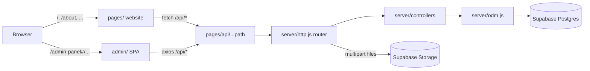

# Probiz Finance

Loan, insurance, investment and business-services marketplace. One Next.js app contains the public website, the admin panel and the API, backed by Supabase (Postgres + file storage).

## Layout

```
Probiz-Finance/
├── pages/                 Public website (Next.js pages router, ~105 routes)
│   └── api/[...path].js   Single entry point for every /api/* request
├── components/            Website UI: site/ (header, footer), templates/, art/ (SVG illustrations), assistant/ (chat), fun/, ui/ (shadcn)
├── lib/                   Catalogue, form schemas, API client, formatting helpers
├── app/admin-panel/       Mounts the admin SPA at /admin-panel (App Router, client-only)
├── admin/                 Admin panel source (React + react-router HashRouter + MUI/Bootstrap)
├── server/
│   ├── routes/            Route table (same paths as the old Express app)
│   ├── controllers/       Request handlers
│   ├── models/            Data schemas (Mongoose-style definitions)
│   ├── middlewares/       File-upload rules per form
│   ├── odm.js             Mongoose-compatible data layer on Postgres JSONB
│   ├── http.js            Express-style router, body/multipart parsing
│   ├── db.js              Postgres (DATABASE_URL) or local PGlite
│   └── storage.js         Supabase Storage (or public/uploads in dev)
├── public/                Static assets (public/admin/images for the admin)
├── styles/                Tailwind + global CSS for the website
└── scripts/               seed-areas.js, smoke-api.sh
```

## How it works



- **API**: `pages/api/[...path].js` hands every request to `server/http.js`, a tiny Express-compatible router. The original route files and controllers run unchanged on top of it, so every endpoint keeps its old path and response shape (`/api/loanOfferDetail`, `/api/getAllUsers`, …).
- **Database**: `server/odm.js` implements the subset of the Mongoose API the controllers use (`find`, `findById`, `save`, `findByIdAndUpdate`, `countDocuments`, filters like `$regex`/`$gte`/`$or`, schema defaults and validation). Each model is one Postgres table `(id, data jsonb, created_at, updated_at)`, created automatically on first use. IDs are UUID strings exposed as `_id`.
- **Uploads**: forms post `multipart/form-data`; `server/middlewares/uploads.js` declares which file types each form accepts. Files go to Supabase Storage and the public URL is saved on the record.
- **Admin**: the former Create React App lives in `admin/` and is rendered client-side at `/admin-panel` (`/admin-panel#/login`, `#/dashboard`, …).
- **Local dev without setup**: if `DATABASE_URL` is empty the app uses PGlite (Postgres compiled to WebAssembly) stored in `.data/pglite`, and uploads go to `public/uploads/`.

Known gaps carried over from the old code:
- Admin endpoints have no authentication (including `POST /api/createAdmin`). Add auth before going live with real data.
- Cashfree and credit-score endpoints are stubs.
- The chat assistant (`components/assistant/`) is rule-based and runs in the browser; it only sends data when a visitor requests a callback (saved as a contact enquiry).

## Local development

Requires Node 20.9+.

```bash
npm install
cp .env.example .env.local     # set JWT_SECRET (openssl rand -hex 32); leave the rest empty
npm run dev                    # http://localhost:3000 and http://localhost:3000/admin-panel
bash scripts/smoke-api.sh      # optional API smoke test
```

Create a first admin account:

```bash
curl -X POST http://localhost:3000/api/createAdmin -H 'content-type: application/json' \
  -d '{"admin_Name":"Admin","admin_Email":"you@example.com","password":"ChangeMe@123"}'
```

Seed the area list with `npm run seed:areas` (stop `npm run dev` first when using local PGlite).

## Supabase setup

1. Create a free project at supabase.com.
2. **Database**: Project Settings → Database → Connection string → *Transaction pooler* (port 6543). Use it as `DATABASE_URL`. Tables are created on first request.
3. **Storage**: Storage → New bucket → name `uploads`, mark **Public**. Copy Project URL → `SUPABASE_URL` and the `service_role` key → `SUPABASE_SERVICE_ROLE_KEY` (server-only; never expose it with a `NEXT_PUBLIC_` prefix).

Free-tier projects pause after 7 days without traffic; they resume from the dashboard.

## Deploy to Vercel

1. Import the GitHub repo in Vercel (framework preset: Next.js, root directory: repo root).
2. Add environment variables: `DATABASE_URL`, `JWT_SECRET`, `SUPABASE_URL`, `SUPABASE_SERVICE_ROLE_KEY`, `SUPABASE_STORAGE_BUCKET`.
3. Deploy. Health check: `/api/health`.

Notes:
- Vercel's Hobby (free) plan is for non-commercial use; a commercial site needs Pro.
- Vercel limits request bodies to 4.5 MB, so a single form submission with many large documents can fail. The fix is direct browser-to-Supabase uploads (signed upload URLs).

### HTTPS and the old "Not secure" warning

The old site ran Express on an EC2 server with a manually installed certificate. That setup caused the warnings:

- The Sectigo certificate for probizfinance.com expired on 16 June 2026 and nothing renewed it.
- The server sent only the site certificate, without the intermediate chain, so some browsers and phones could not verify it even before expiry.
- The same app also served plain http with no redirect or HSTS, so visitors who typed the domain stayed on http.
- The admin panel called the API at `http://<server IP>`, which browsers block or flag on an https page.

On Vercel, certificates are issued and renewed automatically with the full chain, and http redirects to https. `next.config.js` adds HSTS and `upgrade-insecure-requests` on Vercel, and every API call is a relative `/api/...` URL. To move the domain:

1. Vercel → Project → Settings → Domains: add `probizfinance.com` and `www.probizfinance.com` (choose one to redirect to the other).
2. At the DNS provider, set the records Vercel shows (apex `A` record and `www` `CNAME`), and remove the old records pointing at the EC2 server.
3. Wait for Vercel to show the certificate as issued, then check `https://probizfinance.com` in a private window.
4. Shut down the old server so nothing serves the expired certificate.

## Environment variables

| Variable | Required | Purpose |
| --- | --- | --- |
| `DATABASE_URL` | prod | Supabase Postgres connection string (empty = local PGlite) |
| `JWT_SECRET` | yes | Signs login tokens |
| `SUPABASE_URL`, `SUPABASE_SERVICE_ROLE_KEY` | prod | Storage for uploaded documents |
| `SUPABASE_STORAGE_BUCKET` | no | Bucket name, default `uploads` |
| `NEXT_PUBLIC_API_URL` | no | Use an API on another host instead of this app's `/api` |
| `FORCE_HTTPS` | no | Set to `1` at build time to send HSTS and `upgrade-insecure-requests` outside Vercel |
| `NEXT_PUBLIC_CASHFREE_MODE(_PRODUCTION)` | no | Cashfree checkout mode |
