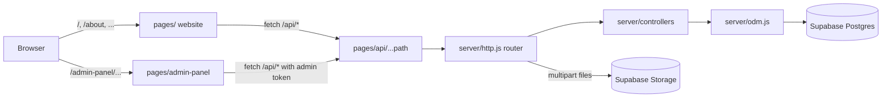

# Probiz Finance

Loan, insurance, investment and business-services marketplace. One Next.js app contains the public website, the admin panel and the API, backed by Supabase (Postgres + file storage).

## Layout

```
Probiz-Finance/
├── pages/                 Public website (Next.js pages router, ~105 routes)
│   └── api/[...path].js   Single entry point for every /api/* request
├── components/            Website UI: site/ (header, footer), templates/, art/ (SVG illustrations), assistant/ (chat), fun/, ui/ (shadcn)
├── lib/                   Catalogue, form schemas, API client, formatting helpers
├── pages/admin-panel/     Admin panel (sign-in, overview, leads, listings, customers, subscribers, team)
├── server/
│   ├── routes/            Route table (same paths as the old Express app)
│   ├── controllers/       Request handlers
│   ├── models/            Data schemas (Mongoose-style definitions)
│   ├── admin/leads.js     Registry of every lead form the admin can work through
│   ├── middlewares/       File-upload rules per form, admin token guard
│   ├── leads/             Lead intake: gate, envelope + events, WhatsApp alert, backfill
│   ├── odm.js             Mongoose-compatible data layer on Postgres JSONB
│   ├── http.js            Express-style router, body/multipart parsing
│   ├── db.js              Postgres (DATABASE_URL) or local PGlite
│   └── storage.js         Supabase Storage (or public/uploads in dev)
├── public/                Static assets
├── styles/                Tailwind + global CSS for the website
└── scripts/               seed-areas.js, smoke-api.sh, check-intake.mjs, backfill-leads.js
```

## How it works



- **API**: `pages/api/[...path].js` hands every request to `server/http.js`, a tiny Express-compatible router. The original route files and controllers run unchanged on top of it, so every endpoint keeps its old path and response shape (`/api/loanOfferDetail`, `/api/getAllUsers`, …).
- **Database**: `server/odm.js` implements the subset of the Mongoose API the controllers use (`find`, `findById`, `save`, `findByIdAndUpdate`, `countDocuments`, filters like `$regex`/`$gte`/`$or`, schema defaults and validation). Each model is one Postgres table `(id, data jsonb, created_at, updated_at)`, created automatically on first use. IDs are UUID strings exposed as `_id`.
- **Uploads**: forms post `multipart/form-data`; `server/middlewares/uploads.js` declares which file types each form accepts. Files go to Supabase Storage and the public URL is saved on the record.
- **Personas**: customers use the Customer tab on `/sign-in`; employees and admins share the Probiz staff tab (or `/admin-panel`), and `POST /api/staffLogin` gives them the role of whichever account the email and password match.

  | | Customer | Employee | Admin |
  | --- | --- | --- | --- |
  | Sign-in | `POST /api/userLogin` | `POST /api/staffLogin` | `POST /api/staffLogin` |
  | Apply, list a property | yes | | |
  | Leads | | own leads + unassigned pool; acting on a pool lead claims it | every lead; assign, reassign, delete, export CSV |
  | Status and notes | | on own leads | on any lead |
  | Property listings | own (website) | view | view, delete |
  | Customers, subscribers | | | yes |
  | Team | | own password | add/remove admins and employees, reset employee passwords |

- **Lead intake**: every way a lead arrives (the ~35 website forms, the assistant's callback, old API URLs, staff-added in-house properties) goes through `server/leads/intake.js`:

  ```mermaid
  flowchart LR
    F["POST /api/leads/:formKey<br/>(or an old form URL)"] --> G{Gate}
    G -->|honeypot filled| X[fake 201, nothing saved]
    G -->|over rate limit| T[429]
    G -->|invalid or no consent| V[400 + field errors]
    G --> C[form controller saves the application]
    C --> L{same product + phone,<br/>open, last 7 days?}
    L -->|yes| R[merge into that Lead<br/>event lead.repeat]
    L -->|no| N[new Lead<br/>event lead.created]
    N --> W[WhatsApp alert to the team]
  ```

  - The full application stays in its per-form table. The `Lead` table holds one row per lead (name, phone, product, status, owner, source, consent, linked customer, repeat count) and `LeadEvent` is its append-only history (created, repeat, assigned, status changed, note, notification sent/failed). The staff panel reads only these two.
  - Validation uses the same rules as the browser (`lib/lead-schema.js` over `lib/forms.js`). Consent is required on website and assistant submissions and stored with its wording and version. The browser sends `_meta` with consent, channel, page, first landing page, external referrer, UTM tags and device (`lib/attribution.js`).
  - Rate limits live in a Postgres `rate_limits` table: 5 submissions per IP per product per 10 minutes, 30 per IP per day. Forwarded IP headers are trusted only on Vercel or with `TRUST_PROXY=1`.
  - A signed-in customer's token links the lead to their account. Uploads are capped at 5 MB per file; wrong types and oversized files are rejected with a message instead of silently dropped.
  - Leads from before this pipeline (and their old `LeadMeta` status, owner and notes) are imported automatically on the first staff-panel request after a server start; `npm run backfill:leads` does the same by hand.
- **Staff panel**: `/api/admin/*` (`server/controllers/adminPanel.controller.js`) lists, filters (status, advisor, product, source) and updates leads. Status, assignment and notes are written as events. Removing an employee returns their open leads to the pool.
- **Access control**: `server/middlewares/staffAuth.js` checks Bearer tokens signed with `role: admin` or `role: employee`. `server/routes/index.js` puts every read of customer data, every update and delete, and the admin-only create endpoints behind `requireAdmin`; employees get 403 there. Public reads (property listings, areas, health) and form submissions stay open. `POST /api/createAdmin` works without a token only while no admin exists.
- **Local dev without setup**: if `DATABASE_URL` is empty the app uses PGlite (Postgres compiled to WebAssembly) stored in `.data/pglite`, and uploads go to `public/uploads/`.

Known gaps carried over from the old code:
- `PUT /api/changeUserPassword/:id` needs no token but does require the user's current password; the website doesn't use it yet.
- Cashfree and credit-score endpoints are stubs.
- The chat assistant (`components/assistant/`) is rule-based and runs in the browser; it only sends data when a visitor requests a callback (a `contact` lead with channel `assistant`).

## Local development

Requires Node 20.9+.

```bash
npm install
cp .env.example .env.local     # set JWT_SECRET (openssl rand -hex 32); leave the rest empty
npm run dev                    # http://localhost:3000 and http://localhost:3000/admin-panel
bash scripts/smoke-api.sh      # optional API smoke test
```

End-to-end lead intake check (every form, validation, consent, honeypot, rate limit, duplicate merge, old URLs, assistant, customer link). Start the server with `TRUST_PROXY=1 npm run dev` so each check can use its own IP, then:

```bash
ADMIN_EMAIL=you@example.com ADMIN_PASSWORD=... CUSTOMER_EMAIL=... CUSTOMER_PASSWORD=... npm run check:intake
```

Create the first admin account (only works while there are no admins; later admins are added from Team in the panel):

```bash
curl -X POST http://localhost:3000/api/createAdmin -H 'content-type: application/json' \
  -d '{"admin_Name":"Admin","admin_Email":"you@example.com","password":"ChangeMe@123"}'
```

Seed the area list with `npm run seed:areas` (stop `npm run dev` first when using local PGlite).

## Supabase setup

1. Create a free project at supabase.com.
2. **Database**: Project Settings → Database → Connection string → *Transaction pooler* (port 6543). Use it as `DATABASE_URL`. Tables are created on first request.
3. **Storage**: Storage → New bucket → name `uploads`, mark **Public**. Copy Project URL → `SUPABASE_URL` and the `service_role` key → `SUPABASE_SERVICE_ROLE_KEY` (server-only; never expose it with a `NEXT_PUBLIC_` prefix).

Free-tier projects pause after 7 days without traffic; they resume from the dashboard.

## Deploy to Vercel

1. Import the GitHub repo in Vercel (framework preset: Next.js, root directory: repo root).
2. Add environment variables: `DATABASE_URL`, `JWT_SECRET`, `SUPABASE_URL`, `SUPABASE_SERVICE_ROLE_KEY`, `SUPABASE_STORAGE_BUCKET`.
3. Deploy. Health check: `/api/health`.

Notes:
- Vercel's Hobby (free) plan is for non-commercial use; a commercial site needs Pro.
- Vercel limits request bodies to 4.5 MB, so a single form submission with many large documents can fail. The fix is direct browser-to-Supabase uploads (signed upload URLs).

### HTTPS and the old "Not secure" warning

The old site ran Express on an EC2 server with a manually installed certificate. That setup caused the warnings:

- The Sectigo certificate for probizfinance.com expired on 16 June 2026 and nothing renewed it.
- The server sent only the site certificate, without the intermediate chain, so some browsers and phones could not verify it even before expiry.
- The same app also served plain http with no redirect or HSTS, so visitors who typed the domain stayed on http.
- The admin panel called the API at `http://<server IP>`, which browsers block or flag on an https page.

On Vercel, certificates are issued and renewed automatically with the full chain, and http redirects to https. `next.config.js` adds HSTS and `upgrade-insecure-requests` on Vercel, and every API call is a relative `/api/...` URL. To move the domain:

1. Vercel → Project → Settings → Domains: add `probizfinance.com` and `www.probizfinance.com` (choose one to redirect to the other).
2. At the DNS provider, set the records Vercel shows (apex `A` record and `www` `CNAME`), and remove the old records pointing at the EC2 server.
3. Wait for Vercel to show the certificate as issued, then check `https://probizfinance.com` in a private window.
4. Shut down the old server so nothing serves the expired certificate.

## Environment variables

| Variable | Required | Purpose |
| --- | --- | --- |
| `DATABASE_URL` | prod | Supabase Postgres connection string (empty = local PGlite) |
| `JWT_SECRET` | yes | Signs login tokens |
| `SUPABASE_URL`, `SUPABASE_SERVICE_ROLE_KEY` | prod | Storage for uploaded documents |
| `SUPABASE_STORAGE_BUCKET` | no | Bucket name, default `uploads` |
| `NEXT_PUBLIC_API_URL` | no | Use an API on another host instead of this app's `/api` |
| `FORCE_HTTPS` | no | Set to `1` at build time to send HSTS and `upgrade-insecure-requests` outside Vercel |
| `TRUST_PROXY` | no | `1` to take the visitor IP from `X-Forwarded-For` (only behind a proxy that sets it; automatic on Vercel) |
| `SITE_URL` | no | Public site URL used in alert links, default `https://probizfinance.com` |
| `WHATSAPP_TOKEN`, `WHATSAPP_PHONE_NUMBER_ID`, `WHATSAPP_TEMPLATE`, `WHATSAPP_ALERT_TO` | no | New-lead WhatsApp alerts; see below |
| `WHATSAPP_TEMPLATE_LANG`, `WHATSAPP_API_VERSION` | no | Template language (default `en`) and Graph API version (default `v21.0`) |
| `NEXT_PUBLIC_CASHFREE_MODE(_PRODUCTION)` | no | Cashfree checkout mode |

### WhatsApp new-lead alerts

Off until all four required variables are set. Each new lead (not repeats) sends a template message through the Meta WhatsApp Cloud API to every number in `WHATSAPP_ALERT_TO`; the result is logged on the lead as "WhatsApp alert sent" or "Alert failed: ...".

1. In Meta Business Manager, add a WhatsApp Business account and a sender phone number. Copy its **Phone number ID** → `WHATSAPP_PHONE_NUMBER_ID`.
2. Create a System User with the `whatsapp_business_messaging` permission and generate a permanent token → `WHATSAPP_TOKEN`.
3. Create a *Utility* message template, e.g. `new_lead`, with four body variables: `New {{1}} lead: {{2}}, {{3}}. Open: {{4}}` (product, name, phone, panel link). Once approved, set `WHATSAPP_TEMPLATE=new_lead`.
4. Set `WHATSAPP_ALERT_TO` to the team's numbers with country code, comma-separated (e.g. `919826000000,919827000000`).
