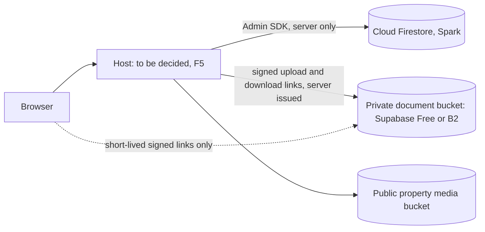

# Probiz Finance: Free-Tier (₹0/month) Strategy

Added in Stage 6 at the user's request. **Mandatory constraint for all later stages:** develop and operate at ₹0/month wherever technically feasible, without weakening authentication, authorisation, data protection or existing features. Paid options are listed separately (section 11) and need explicit approval before any implementation. No billing has been enabled and no cloud resources have been created.

Sources were checked on 2026-11-14. "Verified" means read on the provider's official page that day. `firebase.google.com` returns HTTP 403 on this network, so Firebase-console-only claims are marked unverified. Prices are in USD, excluding taxes. The INR cost depends on the exchange rate and applicable GST.

## 1. Summary

| Layer | Proposed ₹0 option | Status |
|---|---|---|
| Database | Cloud Firestore on the no-cost (Spark) plan: default database, no billing account | Feasible within quotas if the read-saving designs below are adopted |
| Local development | Firebase Emulator Suite (Firestore, Storage) with the `demo-probiz-finance` project | Working (Stage 6) |
| Private documents (Aadhaar, PAN, bank statements) | Supabase Storage **private** bucket (Free plan, already integrated in code) or Backblaze B2 private bucket (first 10 GB free) | Feasible only for low volumes; see section 6 |
| Public property media | Supabase public bucket (as today) | Feasible |
| Hosting (Next.js with server-side APIs) | **No verified option meets every requirement** | Unresolved; see section 4 |
| Backups | Application-level export within the free quota (managed Firestore backups need billing) | Proposed |

The honest answer: the database and low-volume document storage can run at ₹0. **Production hosting cannot be confirmed at ₹0** without either accepting significant risks or verifying terms that could not be checked this session.

## 2. Firebase Spark (no-cost) quotas

| Item | Limit | Status |
|---|---|---|
| Firestore stored data | 1 GiB (index entries count) | Verified |
| Firestore document reads | 50,000 per day | Verified |
| Firestore document writes | 20,000 per day | Verified |
| Firestore document deletes | 20,000 per day | Verified |
| Firestore outbound data | 10 GiB per month | Verified |
| Quota reset | Daily at midnight Pacific time (13:30 IST in winter, 12:30 IST during US daylight saving) | Verified (reset time); IST conversion calculated |
| Free databases | One per project (the default database) | Verified |
| Composite indexes / single-field configurations | 200 each without billing | Verified |
| TTL deletes, PITR, backups, restore, clone | Not free; need billing | Verified |
| Cloud Storage for Firebase | Requires the Blaze plan (user-confirmed requirement) | Not verified this session (403); treated as fact |
| Cloud Run, Cloud Functions, App Hosting | The Google Cloud Free Tier needs a Cloud Billing account | Verified for the Google Cloud Free Tier, which lists Cloud Run and Cloud Run functions |
| Google Cloud Free Trial | Needs a credit card or other payment method | Verified |

Firestore is usable without billing: its limits are documented "when you have not enabled billing" (verified). Creating a Firebase project without a payment method is expected but not verified this session.

## 3. Estimated Firestore consumption

The costs per operation follow the Stage 5 design; section 3.1 has the per-query counts measured in Stage 7. The traffic figures are assumptions to be replaced by measured counts in Stage 11.

| Operation | Reads | Writes |
|---|---|---|
| Staff request guard (every admin request) | 1 | 0 |
| Admin lead list page (20 rows plus about 7 count queries) | about 27 | 0 |
| Lead detail (lead, 1 to 2 applications, about 5 events) | about 8 | 0 |
| Overview, cache miss (decision D1, 30-second cache) | about 140 | 0 |
| New lead submission (rate-limit transaction, application, lead transaction, event) | about 5 | about 6 |
| Lead update or claim (transaction plus event) | about 3 | about 3 |
| Public property list, cache miss, today's design | one read per listing (for example 150) | 0 |
| Public property list from a catalogue snapshot (F1) | 1 | 0 |
| Health check | 1 | 0 |

Sample day: 30 submissions, 200 staff page views (40 overview cache misses), 300 public property-list views, a health check every 10 minutes.

| Component | Reads/day | Writes/day |
|---|---|---|
| Staff pages | about 4,200 | about 30 |
| Overview cache misses | about 5,600 | 0 |
| Submissions | about 150 | about 180 |
| Health checks | about 144 | 0 |
| Public property lists **without** F1 (worst case: every view misses the per-instance cache) | up to about 45,000 | 0 |
| Public property lists **with** F1 | up to about 300 | 0 |
| **Total with F1** | **about 10,400 (21% of 50,000)** | **about 210 (1% of 20,000)** |
| Total without F1 | up to about 55,000 (**over quota**) | about 210 |

Conclusion: writes and storage are comfortable. Reads are safe only if public property pages stop reading every listing on each cache miss (decision F1).

### 3.1 Measured reads per query (Stage 7, emulator)

Measured by `npm run check:firestore-adapter` with the adapter's read meter, which applies Firestore's billing rules: one read per returned or skipped document, at least one per query, one per 1,000 matches for `count()`, and one per requested ID. Test data: 40 areas (35 not deleted), 10 leads, 30 users, 3 employees, 2 admins, 6 properties, 6 lead events.

| Operation | Reads | Note |
|---|---|---|
| `findById`, existing or missing | 1 | direct get |
| `findById` with an ID Firestore cannot store | 0 | answered without a read |
| Equality query (5 matches) | 5 | one per match |
| `countDocuments`, native filter | 1 | `count()` aggregation |
| `countDocuments` with a regex | 40 | reads the whole collection |
| Area page sorted by name, `skip`/`limit` (pushed down) | 12 | two `count()` checks, skipped and returned documents |
| Lead page sorted by `createdAt` descending | 7 | skipped and returned documents |
| Page where some documents lack the sort field | 32 | in-memory fallback reads every match |
| Page with a regex filter | 40 | whole collection |
| `ci()` lookup with an `_lc` copy | 1 | |
| `ci()` on a field without a copy | 6 | in memory |
| Exact case-insensitive regex (today's area-name lookup) | 35 | every non-deleted area |
| Duplicate-check style `findOne` with a sort | 1 | pushed down |
| `findOne` without a sort (5 matches) | 5 | reads every match |
| `$in` (7 matches) / `$in` containing `null` | 7 / 10 | the second runs in memory |
| `$ne` on `_id` | 35 | |
| `{ field: null }`, field declared `default: null` / without default | 5 / 30 | native / in memory |
| Array contains | 1 | |
| `deleteMany` of 4 events | 6 reads, 4 deletes | |
| Unique-field check on save | 1 | |
| Round trip of each of the 47 models (create, read, update, delete) | 6 reads, 2 writes, 1 delete | |

Expensive patterns found (items 1 and 2 fixed in Stage 8; the rest remain and are tracked for later stages):

1. Regex lookups read every candidate document: the area-name lookup costs 35 reads here against 1 with `ci()`, and grows with the collection. Stage 8 switched exact case-insensitive lookups to `ci()` (done).
2. Staff login loads every admin or employee to compare emails in memory. Stage 8 uses `ci()`, 2 reads (done).
3. `countDocuments` or pages with a regex filter read the whole matching set.
4. `findOne` without a sort reads every match. Callers that expect a single match are fine; others get a sort.
5. `{ field: null }` on fields without `default: null` runs in memory.
6. Offset paging bills every skipped document, so deep admin pages cost `skip + limit` reads.
7. Pages whose sort field is missing on some documents fall back to reading every match. `lead.lastActivityAt` is filled by the migration (Stage 10).
8. Legacy full lists without a limit read every document, as they return every row today (for example the public property list, decision F1).

Guard: when a query needs in-memory filtering or paging over more than `FIRESTORE_SCAN_LIMIT` documents (default 2000), it fails with an error instead of reading further or returning partial results.

### 3.2 Transactional flows (Stage 8)

Costs per request without contention, counted from the code paths and confirmed by the adapter meter in `npm run check:transactions`. A lock is one read plus one write of a small `locks` document.

| Flow | Reads | Writes | Before Stage 8 |
|---|---|---|---|
| New lead submission: rate-limit transaction (2 counters), application record, lead transaction (2 locks, ownership check, duplicate check), lead, event | about 7 | about 7 | about 5 / 6 (estimate, no locks) |
| Lead update or claim: staff guard, lead lookup, transactional re-read, lead, events | about 3 plus the lead's events for the response | 1 plus 1 per event | same plus 1 transactional read |
| Staff login | 2 (`ci` lookups) | 0 | every admin and employee |
| Staff-panel employee create | 3 (2 locks, 1 duplicate query) | 3 | every employee |
| Customer signup | 4 (2 locks, 2 duplicate queries) | 3 | 2 |
| Area create or update | 2 (lock, duplicate query) | 2 | 1 / 1 |
| Health check | 1 | 0 | 1 |
| Rate-limit cleanup (about 1 in 100 submissions) | up to 50 | up to 50 deletes | none |

Contention retries repeat the reads of the losing transaction. In the concurrency test, six simultaneous submissions from one phone cost 73 reads and 57 writes in total, including the six application records.

Effect on the sample day: 30 submissions add about 60 reads and 30 writes; staff logins become cheaper. The totals stay at about 21% of the read quota and about 1% of the write quota. Lock documents add about two small documents per lead (well under 1 MB per 1,000 leads).

### 3.3 Website settings (Stage 8.5)

`GET /api/site-settings` reads one document (`site_settings/contact_social`) at most once every 2 minutes per server instance, and the response is cached for 60 seconds by browsers and CDNs. Measured on the emulator: first request 1 read, following requests 0. Even an instance that stays warm all day makes at most 720 reads (under 2% of the 50,000 free reads); serverless instances that start cold make one read each. Admin page loads and saves cost 1 read and 1 write each. Admin changes reach every visitor within about 5 minutes (measured: 120 s across instances, 46 s in a browser on the same instance).

## 4. Hosting options for the existing dynamic Next.js app

The app needs a Node.js server runtime for about 205 API routes and server rendering. It uses `bcryptjs`, `busboy` multipart uploads, `jsonwebtoken`, and `firebase-admin` (gRPC).

### Vercel Hobby (current host)

- **Cost:** Free.
- **Commercial use: not permitted.** Terms §4: "only use the Services under a Hobby plan for your personal or non-commercial use" (verified).
- **Key limits** (verified):
  - 1,000,000 function invocations, 4 CPU-hours, 360 GB-hours and 100 GB data transfer per month.
  - Request body capped at 4.5 MB.
  - 300 s maximum duration.
- **When limits are exceeded:** "wait until 30 days have passed" (verified).
- **Inactivity and suspension:** Hobby projects may be disabled or removed "with or without notice" (verified). Hobby content may be used for AI model training and shared with third parties (Terms §3, verified).
- **Verdict:** Not acceptable for a commercial KYC application.

### Netlify Free

- **Cost:** $0, with 300 credits per month as a hard limit (verified).
- **Commercial use:** Not verified this session.
- **Key limits** (verified):
  - Credits: compute 10 per GB-hour, bandwidth 20 per GB, 2 per 10,000 requests, 15 per production deploy.
  - Private repositories: only the owner can deploy from them; other Git contributors' commits to private repositories need Pro.
- **When credits run out:** Hard limit. Projects stay active past the limit only with paid auto-recharge, so they are expected to pause (inferred).
- **Inactivity and suspension:** Not documented on the pages read.
- **Verdict:** Best free candidate. Its Next.js runtime support and commercial terms must be verified first, and 20 production deploys alone use all 300 credits.

### Cloudflare Workers Free

- **Cost:** Free.
- **Commercial use:** Not verified.
- **Key limits** (verified):
  - 100,000 requests per day.
  - **10 ms CPU per request.**
  - 128 MB memory, 64 MiB Worker size.
  - 100 MB request body.
- **When limits are exceeded:** Error 1027 until 00:00 UTC (05:30 IST) (verified).
- **Inactivity and suspension:** None documented.
- **Verdict:** Not a drop-in fit:
  - The 10 ms CPU limit is too low for bcrypt logins and server rendering.
  - `firebase-admin`'s gRPC client is not expected to run there.
  - It would need a major rewrite.

### Render Free web service

- **Cost:** Free.
- **Commercial use:** Render itself says "Do not use them for production applications" (verified).
- **Key limits** (verified): 750 instance-hours per month, 0.1 CPU and 512 MB, ephemeral disk.
- **When limits are exceeded:** Services are suspended until next month (verified).
- **Inactivity and suspension:** Spins down after 15 minutes idle and takes about a minute to spin back up. It may restart at any time (verified).
- **Verdict:** Not acceptable for production.

### Oracle Cloud Always Free VM

- **Cost:** Free, but **sign-up asks for credit or debit card details** (verified, FAQ).
- **Commercial use:** Not verified.
- **Key limits** (verified):
  - Ampere A1 VMs: up to 2 OCPUs and 12 GB in total.
  - 200 GB block storage, 10 TB outbound data per month.
- **When limits are exceeded:** Not applicable.
- **Inactivity and suspension:** Idle instances may be reclaimed (7 days with CPU, network and memory below 20%), and "out of host capacity" errors can occur (verified).
- **Verdict:** Requires a payment method (needs your approval) and self-managed security patching. A low-traffic site risks reclamation.

### Google Cloud Run or Firebase App Hosting

- **Cost:** Free tier, but a billing account is required (verified for Cloud Run; App Hosting on Blaze is not verified).
- **Commercial use:** Allowed.
- **Key limits** (verified for Cloud Run): 2 million requests per month.
- **When limits are exceeded:** Billed (verified).
- **Verdict:** Excluded: needs billing.

Not evaluated this session: Koyeb, Fly.io, Railway and Deno Deploy.

**Existing functional limitation:** on Vercel, any request over 4.5 MB is rejected with HTTP 413 (verified). The current forms accept up to 30 files of 5 MB each in one request, so multi-document applications may already fail in production. Decision F3 addresses this for any host.

## 5. Proposed ₹0/month architecture

1. **Database:** Firestore on Spark (no billing account), default database, region per D3. All access goes through the Admin SDK on the server; rules deny all client access.
2. **Read budget:**
   - Decision D1 (counts plus a 30 s cache).
   - Decision F1: a catalogue snapshot document for public property pages, plus CDN cache headers.
   - Bounded queries and the backfill marker.
   - Usage measured per endpoint in Stage 11.
3. **Private documents:**
   - Stored in a private bucket on a free provider (decision F2). They are never public.
   - Each upload gets its own one-time, short-lived signed upload URL, scoped to one object path. Files go directly from the browser to storage, with the server validating type and size afterwards (decision F3).
   - Downloads use 10-minute signed links issued after the existing `canSee` check.
4. **Public property media:** public bucket with download URLs, as today.
5. **Development:** emulators only; no cloud resources.
6. **Backups:** weekly application-level export of changed records to the private bucket (decision F6), costing reads within the quota.
7. **Firebase Storage:** emulator use only. It stays a paid fallback (Blaze) and is not used in production without approval.

## 6. Secure free file-storage alternatives

| Option | Free allowance | Security fit | Limits and risks | Status |
|---|---|---|---|---|
| **Supabase Storage, private bucket** (code already uses Supabase Storage) | 1 GB storage, 5 GB egress, 50 MB max upload; 2 active projects | Private buckets with access control (included on Free, verified); server-issued signed URLs | **Free projects pause after 1 week of inactivity** (verified); no backups on Free; commercial-use terms not verified; whether a payment method is needed not verified | Recommended default (no new provider) |
| **Backblaze B2, private bucket** | First 10 GB free; egress free up to 3x the stored amount; Class A, B and C calls free; Class D: first 2,500 per day free (verified) | S3-compatible presigned URLs (standard feature, not verified this session) | Whether a card is needed for the free 10 GB not verified; $6.95/TB/month beyond 10 GB | Recommended if volume exceeds 1 GB |
| Cloudflare R2 | 10 GB-month, 1M Class A, 10M Class B per month, free egress (verified) | Private by default; presigned URLs | Enabling R2 is expected to need a payment method (not verified) | Needs approval if a card is required |
| Oracle Object Storage | 20 GB (Always Free only accounts), 50,000 API requests per month (verified) | Pre-authenticated requests (not verified) | Card at sign-up (verified) | Needs approval |
| Firestore itself (chunked, encrypted blobs) | Shares the 1 GiB quota | Server-only | 1 MiB per document; every download goes through the server; uses read quota | Not recommended beyond tiny volumes |
| Cloud Storage for Firebase | Not on Spark | Good (rules plus signed URLs) | Requires Blaze | Paid fallback only |
| Vercel Blob (Hobby) | Not applicable | | Hobby is non-commercial | Excluded |

**Never** make documents public to save cost. Public buckets are used only for property listing media.

**Stage 9 decision (2026-11-15):** the user chose **Cloud Storage for Firebase** for documents and property media, accepting affordable Blaze billing later if necessary.

- Nothing is billed now: Stage 9 uses the Storage emulator only, and no cloud project or bucket exists.
- Production needs an approved Blaze project with budget alerts.
- Storage cost then follows section 7's volumes (about 450 MB per month of new files at the assumed rates), plus download and operation charges.
- The retention policy (F4) remains the main lever to keep this cost low.
- F2 (Supabase or B2) is superseded for documents; the code keeps the `legacy` provider only for rollback and for files stored before Stage 9.

## 7. Expected storage requirements

The figures below are assumptions to be refined with real production volumes.

| Data | Assumption | Growth | Free allowance lasts |
|---|---|---|---|
| Firestore records (leads, applications, events, indexes) | 900 submissions/month × about 10 KB each including index entries | about 9 MB/month | 1 GiB: several years |
| Private KYC documents | 100 document-bearing applications/month × 4 files × about 1 MB | about 400 MB/month | Supabase 1 GB: under 3 months; B2 10 GB: about 2 years |
| Property media | 20 listings/month × 5 images × about 0.5 MB | about 50 MB/month | Shares the same bucket quotas |

Documents are the binding constraint. Staying at ₹0 long term needs a retention policy (decision F4, for example removing documents some period after an application closes, as the business and compliance owners decide) or a move to the low-cost paid tier in section 11.

## 8. Free-tier exhaustion behaviour

| Service | What happens | Status |
|---|---|---|
| Firestore (no billing) | Reads, writes or deletes beyond the daily amounts are expected to fail until the reset (12:30 or 13:30 IST), which would stop logins, lead intake and the admin panel for the rest of the Indian business day | Reset time verified; failure behaviour expected, not verified |
| Vercel Hobby | Feature unavailable until 30 days pass | Verified |
| Netlify Free | Hard credit limit; projects stay active only with paid auto-recharge | Inferred |
| Cloudflare Workers Free | Error 1027 (or fail-open bypass) until 00:00 UTC | Verified |
| Render Free | Free services suspended until next month | Verified |
| Supabase Free | Not documented on the pages read | Not verified |
| Backblaze B2 | Usage above 10 GB is billable | Verified (price); behaviour without a card not verified |

## 9. Inactivity and suspension policies

| Service | Policy | Status |
|---|---|---|
| Supabase Free | Projects paused after 1 week of inactivity; can be resumed | Verified |
| Render Free | Spin-down after 15 minutes idle; free Postgres expires after 30 days and is deleted 14 days later | Verified |
| Oracle Always Free | Idle compute instances may be reclaimed | Verified |
| Vercel Hobby | Projects may be disabled or removed without notice at Vercel's discretion | Verified |
| Google Cloud Free Trial | Ends after 90 days or $300; resources stopped and deleted after a 30-day grace period | Verified |
| Firebase Spark project | Not documented on the pages read | Not verified |

## 10. Risks of free hosting and functions that cannot be safely free

Risks:

- **No service-level agreements or paid support.** Providers may change or withdraw free tiers; Google promises 30 days' notice for Free Tier changes (verified).
- **Terms violations.** Running a commercial service on a non-commercial plan risks sudden takedown and data-handling exposure.
- **Quota exhaustion during business hours.** This means lost leads.
- **Inactivity pausing.** This is especially relevant to Supabase Free during quiet weeks.
- **Shared multi-tenant infrastructure.** Account-level suspensions can affect the whole business.

Functions that cannot be supported securely at ₹0:

1. **Commercial production hosting**, with confidence (section 4). Unresolved, decision F5.
2. **Managed backups and point-in-time recovery** for Firestore (billing required, verified). The mitigation (F6) is weaker than managed backups.
3. **Automatic TTL deletion** (billing required). Replaced by in-code cleanup.
4. **Large-volume document storage.** Beyond 1 GB (Supabase) or 10 GB (B2), a retention policy or payment is needed.
5. **Malware scanning of uploads.** Not available free. Mitigated by content-type checks, a no-execution policy and serving from the storage domain.
6. **Cloud Storage for Firebase** (Blaze).
7. **Uptime guarantees and paid support** on any layer.
8. **Third-party paid services already in the code.** The WhatsApp Cloud API, the Cashfree payment gateway and the credit-bureau provider have their own pricing (not evaluated). They stay disabled when their environment variables are empty.

## 11. Paid fallback options (separate from the free plan; each needs approval)

| Need | Option | Price (verified on 2026-11-14 unless marked) | Notes |
|---|---|---|---|
| Hosting, smallest change | Netlify Personal | $9/month, 1,000 credits, optional $5 packs of 500 credits | Same platform as the free candidate |
| Hosting, team | Netlify Pro | $20/month, 3,000 credits, unlimited members | Needed for other contributors' commits to private repositories |
| Hosting, current platform | Vercel Pro | $20 per developer seat/month | Allows commercial use; Vercel automatically charges on-demand usage beyond the included credit (verified) |
| Hosting, Cloudflare | Workers Paid | from $5/month | Needs a major rewrite (CPU, gRPC); not recommended |
| Documents beyond the free tier | Backblaze B2 | $6.95/TB/month after 10 GB (for example 50 GB about $0.35/month) | Lowest-cost secure option |
| Documents, managed | Supabase Pro | $25/month (100 GB storage, daily backups kept 7 days, no pausing) | Also removes the pausing risk for Postgres |
| Documents, Firebase | Blaze plus Cloud Storage | Pay as you go; the free amount applies only in US regions (verified) | Needs billing and a card |
| Database beyond quota or managed backups | Firestore on Blaze | Pay as you go (rates not re-checked this session) | Budgets only alert; they do not cap spending (verified) |

Minimum expected cost if the free hosting candidate fails verification: **about $9/month (Netlify Personal), or $20/month if more than one person must deploy from the private repository**, plus applicable taxes. Database and document storage can remain at ₹0 at low volumes.

## 12. Decisions requested (free-first)

| ID | Decision | Recommendation |
|---|---|---|
| F1 | Public property pages read one catalogue snapshot document (rebuilt on admin changes) and send CDN cache headers | Yes: keeps public reads near-constant |
| F2 | Production document storage: Supabase private bucket (default) or Backblaze B2 private bucket | Supabase now; B2 when volume nears 1 GB |
| F3 | Direct-to-storage uploads using server-issued, single-use, short-lived signed upload URLs, with server-side validation after upload | Yes: avoids host body limits and never exposes documents publicly |
| F4 | Document retention policy | Business and compliance decision |
| F5 | Production host | Verify Netlify Free terms and Next.js support; otherwise approve a paid fallback |
| F6 | Weekly application-level backup export to the private bucket | Yes |

Stage 7 (Firestore provider) does not depend on F2 to F6. F1 affects Stage 8.
