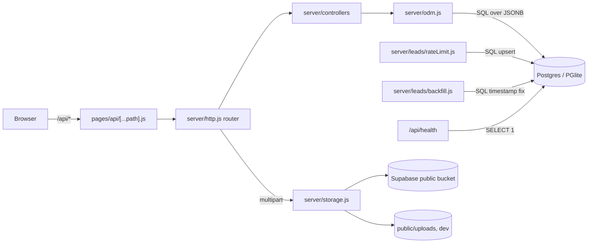
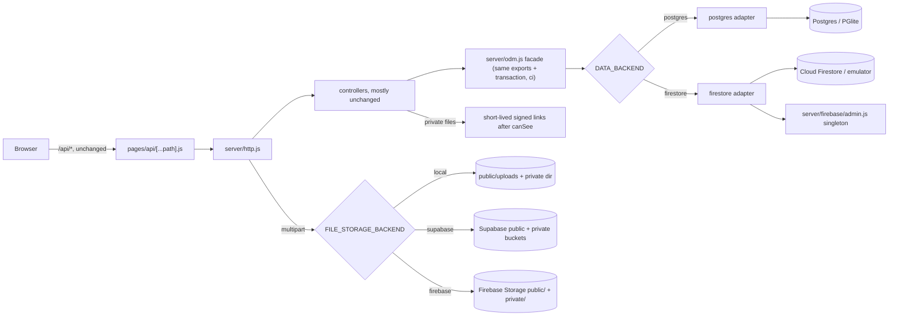

# Probiz Finance: Firebase Architecture

Stage 5 design document. Nothing in this document is implemented yet. Branch `shivansh_dev`, base commit `9f2bb93`.

Companion documents: [firebase-data-model.md](firebase-data-model.md), [firebase-security-plan.md](firebase-security-plan.md), [firebase-migration-plan.md](firebase-migration-plan.md), [FIREBASE_FREE_TIER_STRATEGY.md](FIREBASE_FREE_TIER_STRATEGY.md). Progress is tracked in [FIREBASE_IMPLEMENTATION_LOG.md](FIREBASE_IMPLEMENTATION_LOG.md).

**Mandatory constraint (added in Stage 6):** operate at ₹0/month wherever technically feasible: Firebase Spark (no billing), Firestore within its free quotas, emulators for development, no billing or payment-method services without approval, and sensitive documents never made public. Where a choice below conflicts with this, [FIREBASE_FREE_TIER_STRATEGY.md](FIREBASE_FREE_TIER_STRATEGY.md) takes precedence.

## 1. Scope

In scope for this phase:

- Cloud Firestore (Standard edition, default database) as a selectable persistence backend, accessed only from the server through the Firebase Admin SDK.
- The existing Postgres/PGlite backend kept as a fallback and rollback path, selected by configuration.
- Race-safe handling of lead claiming, duplicate-lead merging, rate limiting and unique values.
- Removal of SQL assumptions from the Firestore path (rate limits, backfill, health check, timestamp fix).
- A file-storage abstraction with explicit public (listing media) and private (applicant documents) visibility, with local, Supabase and Firebase providers. Production uses a free private-bucket provider (decision F2); the Firebase provider is for the emulator and a paid fallback only.
- Local development and tests on the Firebase Emulator Suite.
- A migration tool from Postgres/PGlite to Firestore.

Out of scope for this phase:

- **Firebase Authentication.** Logins, bcrypt hashes and JWT contracts are used by the website, the admin panel and the test scripts, for three personas with their own role model. Changing the identity provider would change every login flow and token at the same time as the database. Keeping one moving part per phase keeps the change reviewable and reversible.
- Changing the production host. Vercel Hobby only allows personal or non-commercial use (verified), so the host is an open decision (F5 in the free-tier strategy); Firebase Hosting, App Hosting and Cloud Functions need billing and are not used.
- Any Firebase client SDK in the browser. The browser keeps calling the existing `/api/*` endpoints.

## 2. Sources checked (2026-11-14)

`firebase.google.com` returned HTTP 403 from this network (both the fetch tool and Node), so Firebase-console-level pricing pages could not be read. Facts below are marked accordingly.

| Fact | Source | Status |
|---|---|---|
| Firestore free tier: 1 GiB stored, 50,000 reads/day, 20,000 writes/day, 20,000 deletes/day, 10 GiB/month outbound; resets around midnight Pacific; one free database per project | https://cloud.google.com/firestore/pricing, https://docs.cloud.google.com/firestore/quotas | Verified |
| Named (non-default) databases, TTL deletes, PITR, backups, restore and clone have no free usage and need billing | Same | Verified |
| Aggregation queries (`count()`) are billed per batch of up to 1,000 index entries read, minimum one read; offsets are billed one read per skipped document; every query costs at least one read | https://cloud.google.com/firestore/pricing | Verified |
| Requests keep succeeding after a Google Cloud budget is exceeded; budgets only alert | Same | Verified |
| Limits: document 1 MiB; map/array depth 20; request 10 MiB; transaction 270 s with 60 s idle; lock deadline 20 s; 200 composite indexes without billing | https://docs.cloud.google.com/firestore/quotas, https://docs.cloud.google.com/firestore/docs/manage-data/transactions | Verified |
| Transactions: reads before writes, automatic retry on contention, all-or-nothing | https://docs.cloud.google.com/firestore/docs/manage-data/transactions | Verified |
| Queries: `in` up to 30 values, `or` up to 30 disjunctions, `not-in` up to 10, `!=` and `not-in` exclude documents missing the field, `orderBy` excludes documents missing the field; composite index needed to combine equality with inequality | https://docs.cloud.google.com/firestore/docs/query-data/queries | Verified |
| Cloud Storage Always Free: 5 GB-months Standard storage, 5,000 Class A and 50,000 Class B operations per month, only in US-WEST1, US-CENTRAL1, US-EAST1 | https://cloud.google.com/storage/pricing | Verified |
| V4 signed URLs: maximum expiry 7 days; generated with a service account (or HMAC key) | https://docs.cloud.google.com/storage/docs/access-control/signed-urls | Verified |
| Firebase CLI latest `firebase-tools` 15.36.0, `engines.node` `>=20.0.0` | npm registry metadata | Verified |
| Emulators need Java on PATH or `JAVA_HOME` | `firebase-tools` source `src/emulator/commandUtils.ts` | Verified; minimum Java version not confirmed |
| App Hosting backend setup enables Cloud Build, Cloud Run, Artifact Registry, Secret Manager, Developer Connect and IAM APIs | `firebase-tools` source `src/apphosting/backend.ts` | Verified |
| `firebase-admin` is on Next.js's built-in `serverExternalPackages` list | `node_modules/next/dist/docs/02-pages/04-api-reference/04-config/01-next-config-js/serverExternalPackages.md` | Verified |
| Cloud Storage for Firebase default buckets require the Blaze plan | Firebase announcement (firebase.google.com) | **Not verified this session (403)** |
| Firebase App Hosting requires the Blaze plan | firebase.google.com | **Not verified this session (403)**; consistent with the billed services it enables |
| Next.js server rendering on classic Firebase Hosting relies on Cloud Functions, which require Blaze | firebase.google.com | **Not verified this session (403)** |

Unverified items are treated as "assume billing is required" and must be confirmed in the Firebase console before any decision depends on them.

## 3. Current architecture



## 4. Target architecture



The production host is an open decision (F5 in [FIREBASE_FREE_TIER_STRATEGY.md](FIREBASE_FREE_TIER_STRATEGY.md)); the design runs on any Node.js host. Firestore is reached over the network with service-account credentials held in server-only environment variables.

## 5. Hosting and pricing decision

| Component | Plan needed | Decision |
|---|---|---|
| Cloud Firestore, default database, Standard edition | Free daily quota without billing (verified) | Use |
| Firestore named databases, TTL, PITR, backups | Billing (verified) | Not used. Only the default database. Rate-limit cleanup is done in code, not with TTL |
| Cloud Storage for Firebase | Blaze (user-confirmed requirement; page not readable here) | Emulator and paid fallback only. Production documents use a free private bucket (decision F2) |
| Firebase App Hosting, Cloud Run, Cloud Functions | Billing account (verified for the Google Cloud Free Tier) | Not used |
| Classic Firebase Hosting | Static hosting; server rendering and the `/api` router would need Cloud Functions (not verified) | Not used |
| Vercel Hobby (current host) | Free, personal or non-commercial use only (verified) | Not acceptable for production; host decided under F5 |
| Emulator Suite | Free, local | Use for development and tests (working since Stage 6) |

Free-quota behaviour: on a project without billing, reads, writes and deletes beyond the daily free amounts are refused until the quota resets around midnight Pacific. The design therefore treats read amplification as a functional risk, not just a cost (section 8).

## 6. Configuration

| Variable | Values / example | Purpose |
|---|---|---|
| `DATA_BACKEND` | `postgres` (default), `firestore` | Selects the persistence adapter |
| `DATABASE_URL` | empty or Postgres URL | Postgres adapter: empty means PGlite |
| `PGLITE_DIR` | path, default `.data/pglite` | Proposed small addition so tests can use an isolated PGlite directory (Stage 4B finding) |
| `FIREBASE_PROJECT_ID` | `probiz-...` | Project for the Admin SDK |
| `FIREBASE_CLIENT_EMAIL` | service-account email | Credential (external hosts such as Vercel) |
| `FIREBASE_PRIVATE_KEY` | PEM with `\n` escapes | Credential; escaped newlines converted at runtime; never logged |
| `FIREBASE_STORAGE_BUCKET` | bucket name | Firebase Storage provider |
| `FIRESTORE_EMULATOR_HOST` | `127.0.0.1:8080` | Emulator mode (no credentials) |
| `FIREBASE_STORAGE_EMULATOR_HOST` | `127.0.0.1:9199` | Storage emulator |
| `GCLOUD_PROJECT` | `demo-probiz-finance` | Project id in emulator mode |
| `FILE_STORAGE_BACKEND` | `local`, `supabase`, `firebase` | Storage provider; default keeps today's behaviour (Supabase when configured, otherwise local) |
| `PRIVATE_FILE_URL_TTL_SECONDS` | default `600` | Lifetime of private file links (5 to 15 minutes allowed) |
| `FIRESTORE_SCAN_LIMIT` | default `2000` | Cap for bounded in-memory filtering (section 7.5) |
| `LEAD_BACKFILL_AUTO` | `0` / `1` | Automatic backfill check; default on for Postgres, off for Firestore |
| `JWT_SECRET` | unchanged | Unchanged |

No Firebase credential is ever read from a `NEXT_PUBLIC_*` variable (Next inlines those into the browser bundle at build time).

## 7. Data layer design

### 7.1 Facade

`server/odm.js` keeps its exports (`Schema`, `model`, `Types`, `ValidationError`, `CastError`, `Promise`, `saveTracker`) so the 47 model files and the controllers do not change. Two additions:

- `ci(value)`: marks a filter value as case-insensitive exact match (section 7.10). Implemented in Stage 7 as `{ $ci: value }`, translated by both adapters.
- `transaction(fn)`: runs `fn(tx)` atomically on either backend (section 7.8). Implemented in Stage 8.

Schema compilation, casting, defaults, validation, update operators, projection and `saveTracker` stay shared. Only persistence moves behind an adapter.

### 7.2 Module layout (implemented in Stages 7 and 8)

```
server/odm.js                 facade, schema, casting, validation, update operators (shared)
server/data/index.js          picks the adapter from DATA_BACKEND (default postgres); transaction()
server/data/tx.js             active transaction (AsyncLocalStorage), retry undo, after-commit callbacks (Stage 8)
server/data/values.js         value helpers moved out of odm.js (casting, field lookup, path check, JSON values)
server/data/postgres.js       the SQL from odm.js (unchanged outside transactions), transactions, rate limits
server/data/firestore.js      Firestore adapter: planner, matcher, sorting, conversions, transactions, rate limits, read meter
server/firebase/admin.js      Firebase Admin singleton (server only, Stage 6)
server/storage.js             storage facade (Stage 9)
```

Differences from the Stage 5 proposal: only Firestore needs the planner and matcher, so they live in `firestore.js` instead of `plan.js`. There is no `unique.js`: uniqueness uses locks and in-transaction checks (section 7.9).

Backend selection (`server/data/index.js`):

- `DATA_BACKEND` unset or `postgres`: the Postgres adapter (`DATABASE_URL`, otherwise PGlite). `firebase-admin` is not loaded (verified).
- `DATA_BACKEND=firestore` is refused unless `FIRESTORE_EMULATOR_HOST` is set. Since Stage 8 nothing in the application calls SQL directly, so the whole app runs on the emulator (verified: smoke test and 86 intake checks). Using a real Firebase project needs a later, separately approved stage.

### 7.3 Adapter interface (implemented)

Based only on what the code calls (Stage 4A item 28):

| Method | Returns | Used by |
|---|---|---|
| `insert(Model, id, data, { createdAt })` | `{ created_at, updated_at }` | `save()` on new documents (`create()`); `createdAt` keeps the original time of backfilled leads (Stage 8) |
| `update(Model, id, data, { partial, createdAt })` | `{ created_at, updated_at }`, or `null` when the record no longer exists (as Postgres) | `save()` on loaded documents; `findByIdAndUpdate`, `findOneAndUpdate`, `updateOne`, `updateMany` (load, apply operators, save) |
| `remove(Model, id)` | | `doc.deleteOne()`, `findByIdAndDelete`, `findOneAndDelete` |
| `removeMany(Model, ids)` | | `deleteMany` (Postgres: one `DELETE` per ID, as before; Firestore: batches of 500) |
| `find(Model, filter, { sort, skip, limit })` | `[{ id, data, created_at, updated_at }]` in Postgres order | `find`, `findOne` (`limit 1`), `findById`, and the read step of updates and deletes |
| `count(Model, filter)` | number | `countDocuments` |
| `hasOther(Model, id, filter)` | boolean | unique-field check in `save()` (the original SQL) |
| `ping()` | | `/api/health` (Stage 8) |
| `transaction(fn)` | result of `fn` | ODM `transaction()` (Stage 8, section 7.8) |
| `rateLimit(rules)` | boolean | `server/leads/rateLimit.js` (Stage 8, section 8.9) |

All methods run inside the active transaction when called within `transaction()`.

### 7.4 Firestore document shape

- Collection name = the existing table name from `tableName(modelName)` (for example `lead`, `lead_event`, `property_in_house`), so migration and rollback map one to one.
- Document ID = the existing UUID `_id`. `_id` is not stored inside the document.
- Every document stores `createdAt` and `updatedAt` as Firestore Timestamps, including models without `timestamps: true` (`Property InHouse`), mirroring the Postgres columns. They are exposed on read only when the schema has timestamps, exactly like today. Precision is milliseconds (Postgres keeps microseconds).
- Case-insensitive lookup copies live in a reserved map `_lc`, written by the adapter on every insert and update and stripped on read. Implemented for `area.name`, `admin.admin_Email`, `employee.email` and `user.user_Email`.
- Values: data is first normalised exactly as Postgres stores it (JSON round trip): `undefined` is dropped, and `Date` values inside `Mixed` fields (for example `Lead.consent.at`) become ISO strings, which is what Postgres returns today. Fields typed `Date` in the schema, including inside arrays and nested objects (for example `lead_meta.notes[].at`), are stored as Timestamps and returned as `Date`.
- Fields declared `default: null` are written as an explicit `null` on every full save (also after the field is unset), so `{ field: null }` can be answered natively.

### 7.5 Query planning

Each filter is split into a native Firestore part and a residual part:

Implemented in Stage 7 (`server/data/firestore.js`):

| Filter used by the code | Firestore translation |
|---|---|
| `_id` equality or `$in` (plus other conditions) | Direct document gets (one read per ID); other conditions checked in memory |
| `$ne` on `_id` | Native part of the query; the one document is dropped in memory |
| `createdAt` / `updatedAt` equality and ranges | Native, on the stored Timestamps |
| Scalar equality | `==` |
| `{ field: null }` | `== null` when the field is declared `default: null` (always stored); otherwise in memory (null or missing) |
| Scalar equality on an array field | `array-contains` (one per query) |
| `$ne: null` | `!= null` (one per query) |
| `$in` (up to 30 scalar values) | `in`; `array-contains-any` on array fields |
| `$gt`, `$gte`, `$lt`, `$lte` | Native on Number, Date, String and ObjectId fields (composite index where combined with equality) |
| `$or` of equalities or `$in` (top level, up to 30 combinations) | `Filter.or` |
| `ci(value)` (`$ci`) | `_lc.<field> ==` lower-cased value; in memory for fields without a copy |
| `$and` | Its parts are planned individually |
| `$ne` with a value, `$nin`, `$exists`, RegExp / `$regex`, `$in` containing `null`, `$nor`, nested `$or`, object or array equality | In memory |
| Any other operator, or an invalid field path | Error with the same message as the SQL builder |

Residual handling: in-memory conditions use a matcher that reproduces the SQL semantics (jsonb equality and containment, the `#>>` text form for regex, type-gated ranges, null-or-missing). The native part only narrows the read; the matcher re-checks the complete filter on every row. Pushed-down pages are re-checked as well and raise an error instead of returning a wrong row.

When a query has an in-memory part or asks for `skip`/`limit`, the read is limited to `FIRESTORE_SCAN_LIMIT + 1` documents (default 2000). If more documents match the native part, the query fails with `FirestoreScanLimitError` (`code: 'SCAN_LIMIT'`) instead of returning partial results. Plain native queries without a window return every match, exactly like Postgres, and log a warning when they exceed the limit.

Null and missing fields (verified in `server/odm.js` and the Firestore docs): today `{ field: null }` matches documents where the field is null **or missing**. Firestore `== null` matches only stored nulls, and an `orderBy` or index on a field skips documents that lack it. Rules that keep results identical:

- Fields declared with `default: null` are always stored explicitly (the adapter writes `null` on every full save; the migration fills them on older records). This covers `lead.assignedTo` for the unassigned scope and pool. Other `{ field: null }` filters are evaluated in memory.
- `lead.lastActivityAt` is always set. The admin list already sorts by `lastActivityAt || createdAt`, so the migration writes `createdAt` where it is missing or null (a reported transform).
- Other equality filters (`deleteFlag: false`, `status: 'new'`) already ignore missing fields in Postgres (`COALESCE(..., FALSE)`), so they behave the same in Firestore.

### 7.6 Sorting, paging and counts

- Queries without `limit`/`skip` read every match anyway, so they are sorted in memory: requested sort, or `createdAt asc, id asc` by default (same as today's `created_at, id`). This needs no composite index and costs the same number of reads.
- In-memory sorting follows Postgres: jsonb type order (null, string, number, boolean, array, object), missing values last when ascending and first when descending, ties broken by ID.
- `findOne` without a sort reads all matches (bounded by `FIRESTORE_SCAN_LIMIT`) and returns the earliest, matching Postgres. In practice these are unique lookups with 0 or 1 match.
- Queries with `skip`/`limit` (including `findOne` with a sort) push `orderBy`, offset and limit to Firestore only when there is no in-memory condition, the sort fields are scalar, and any range filter is on the first sort field. Firestore leaves out documents that lack an `orderBy` field, so the push happens only when the sort fields always exist (`createdAt`/`updatedAt`, or a field constrained by a native filter), or when two `count()` queries show that no match lacks them. Results within `skip + limit + 20` are sorted in memory instead. These pushed-down queries are the only ones that need composite indexes (listed in the data model; the emulator does not enforce them).
- Descending pushed-down sorts return documents with equal sort values in descending ID order (Firestore's rule); Postgres returns them in ascending ID order. In-memory sorts match Postgres.
- Sort by `_id` means `createdAt` (same as today).
- `skip`: Firestore offset (billed one read per skipped document; used by the area list and the admin lead list pages).
- `countDocuments`: `count()` aggregation (one read per 1,000 matches) for native filters; bounded in-memory counting otherwise.
- `select`: applied in memory after reading (Firestore bills per document regardless of field mask). Partial saves after a projection use field-level `update()`, matching Postgres's shallow `data || $2` merge.

### 7.7 Writes

- Insert: `create()` (fails if the ID exists) with `createdAt` and `updatedAt`.
- Full update: `update()` with the cast document plus `updatedAt`; schema fields that are no longer set are deleted, matching Postgres `data = $2`. `createdAt` is kept.
- Partial update (after `select`): `update()` of the loaded fields only, matching `data || $2`.
- Updating a record that no longer exists changes nothing and returns no row, as in Postgres.
- Delete: `delete()`; `deleteMany` uses batches of 500.
- Unique fields: since Stage 8 the duplicate check and the write run in one transaction, locked on the value (section 7.9).

### 7.8 Transactions and locks

Status: implemented in Stage 8 (`server/data/tx.js` and both adapters).

API: `transaction(async (tx) => ...)` from `server/odm.js`. Inside it, ordinary ODM calls (`find`, `findOne`, `findById`, `save`, `create`, `deleteOne`, ...) run in the transaction automatically (the active transaction is tracked with `AsyncLocalStorage`), so no separate `tx.get`/`tx.save` methods are needed. `tx` provides:

- `tx.lock(...keys)`: serialises transactions that use the same key; keys are sorted so locks are always taken in the same order.
- `tx.afterCommit(fn)`: runs `fn` only after a successful commit (events, WhatsApp alerts).
- `tx.onRetry(fn)`: undoes in-memory state when an attempt is retried (used by `save()` for `$isNew` and timestamps).

A nested `transaction()` joins the outer one. Transaction functions may run more than once (up to 5 attempts), so side effects belong in `afterCommit`.

- Firestore: native `runTransaction`. Reads (`get`, queries, `count()`, `getAll`) use the transaction; writes are buffered and applied at the end, because Firestore requires all reads before writes (so reads inside a transaction do not see its own writes). `tx.lock(key)` reads and rewrites `locks/{sha256(key)}`, so two transactions on the same key conflict and Firestore retries one.
- Postgres: native `BEGIN ... COMMIT` on one connection (postgres.js `sql.begin`, which works through Supabase's transaction pooler; PGlite `transaction`). Every `SELECT` inside a transaction adds `FOR UPDATE`, so rows that are read stay locked until the commit (no lost updates). `tx.lock(key)` uses `pg_advisory_xact_lock(hashtextextended(key, 0))`, which also protects values that do not exist yet. Serialization failures (`40001`) and deadlocks (`40P01`) are retried. Outside transactions the SQL is unchanged (verified: 20 of 20 statements identical to `HEAD`).

Event emission and WhatsApp alerts run after commit.

### 7.9 Unique values

Status: implemented in Stage 8, differently from the Stage 5 proposal.

Each create (or `save()` of a model with `unique: true`) runs its duplicate query and its write in one transaction, after `tx.lock('unique:<collection>:<field>:<value>')`. Concurrent requests for the same value are serialised; the second one sees the first one's record and gets the existing duplicate response. This replaces the proposed `unique_keys` reservation documents: there is nothing to migrate, move or release on soft delete, and the scope of each rule is simply its query. The rules actually enforced are listed in the data model (section 4); they keep today's matching, except that `createAdmin` now ignores case (emails are stored in lower case) and the staff-panel employee check compares trimmed values.

The Stage 5 proposal (kept for reference):

| Collection | Field | Normalisation | Scope |
|---|---|---|---|
| `area` | `name` | trimmed, exact (as today) | all records (as today) |
| `admin` | `admin_Email` | trimmed, lower-case | all records (`createAdmin` checks all) |
| `employee` | `email` | trimmed, lower-case | non-deleted only (released on soft delete) |
| `employee` | `employeeId` | trimmed | non-deleted only |
| `user` | `user_Email` | trimmed, lower-case | all records (decision D2: case-insensitive is stricter than today) |
| `user` | `mobile_no` | digits only | all records |

Controllers keep their friendly duplicate responses. Decision D2 (case-insensitive customer email) is still pending, so signup keeps the exact match.

### 7.10 Case-insensitive lookups

Status: implemented. `ci()` and `$ci` exist in both adapters (Stage 7); the callers below use them since Stage 8.

`ci(value)` replaces regex-based exact lookups and in-memory email matching:

- `Admin.findOne({ admin_Email: ci(email), deleteFlag: false })` and the employee equivalent in staff login (no more loading every account).
- `Area.findOne({ name: ci(areaName), deleteFlag: false })` instead of `new RegExp('^' + name + '$', 'i')` (also fixes regex injection).

Postgres translates `ci` to `COALESCE(lower(data #>> '{field}') = lower($1), FALSE)`; Firestore to `_lc.field == lower(value)`, or an in-memory check for fields without a copy. A `null` value matches nothing on both backends.

## 8. Business flows

### 8.1 Lead intake and seven-day duplicate merge

Status: implemented in Stage 8 (`upsertLead` in `server/leads/intake.js`). The transaction also locks `lead:ref:<type>:<record id>` and first checks whether an envelope already holds the record, so the intake and the backfill cannot both create one. Verified: six simultaneous submissions from one phone give one lead with five repeats on both backends.

Inside one transaction: `tx.lock('lead:' + dedupeKey)`, find the newest open lead for the key with `lastActivityAt >= now - 7 days`, then either update it (append `refId`, increment `repeatCount`, refresh summary fields) or create a new lead. Events (`lead.created` / `lead.repeat`) and listeners run after commit. Two concurrent submissions for the same product and phone now produce one lead and one repeat.

### 8.2 Lead update and claiming

Status: implemented in Stage 8. Verified: two employees claiming at once get 200 and 403; a status change and a reassignment sent at once are both kept.

`PATCH /api/admin/leads/:type/:id` runs its read-modify-write in one transaction. An employee's claim only succeeds if `assignedTo` is still empty inside the transaction; otherwise the request gets 403 "This lead belongs to another advisor." Status, notes and assignment changes can no longer overwrite each other. Events are emitted after commit.

### 8.3 Lead deletion

Delete the per-form records, the lead's events and the lead in batches; then delete the stored files of those records through the storage provider (section 10).

### 8.4 Employee removal

Status: implemented in Stage 8 (each open lead is re-read and unassigned in its own transaction; uniqueness needs no release step, section 7.9). The query is still `Lead.find({ assignedTo })`.

Soft delete releases the employee's unique reservations; their open leads are found with an indexed `assignedTo == id` query and returned to the pool, each in its own transaction, with `lead.unassigned` events.

### 8.5 Admin lead list

Native query with equality filters for type, scope (`assignedTo == me`, `assignedTo == null`, `assignedTo == employee`; employees see `assignedTo == null OR assignedTo == me` through `Filter.or`, to be verified on the emulator together with ordering and offset), channel (`source.channel`) and status, ordered by `lastActivityAt desc`, with limit and offset for the page. `total` and `statusCounts` come from `count()` aggregations with the same filters. Search `q`: a 10-digit number becomes `phone == number` (indexed); other text uses the bounded fallback over the most recent `FIRESTORE_SCAN_LIMIT` matching leads, and the response adds `searchLimited: true` when the cap was reached (new field; existing fields unchanged).

### 8.6 Overview and employee statistics (decision D1)

| Option | Reads per overview | Write-path change | Notes |
|---|---|---|---|
| A. Counter documents updated in the same transactions as lead writes, plus a recompute script | about 15 | Yes (every lead write) | Cheapest reads; one counter document becomes a write hotspot (fine at current volumes) |
| **B. `count()` aggregations per request plus a 30-second per-instance cache (recommended)** | about 140 (fixed, independent of lead count) | No | Simple and correct; about 25,000 reads/day at 180 overview loads/day |
| C. Keep loading every lead, with a cache | grows with lead count | No | Breaks the free quota once leads reach a few thousand |

B breakdown: 5 status counts, total, last 7 and last 30 days, unassigned, 30 daily counts, 37 types x 2 counts, 2 counts per employee, 8 recent and 5 pool documents, and the customer/listing/subscriber counts.

### 8.7 Staff and customer lookups

Status: staff login (`staffLogin`, `employeeLogin`) uses `ci` since Stage 8.

Staff login: two indexed `ci` equality queries (admin first, as today). Staff guard: one read by ID per request (unchanged). Customer signup checks: indexed equality on email and mobile.

### 8.8 Area and property search

Status: since Stage 8 the exact area lookups in `addProperty` and `UpdatePropertyById` use `ci`. The public filters (`getAllAreas` `search`/`city`/`state`, `getFilterProperties` `areaName`) escape the request text before building their case-insensitive regex. Results for normal text are unchanged, but injected patterns no longer run. Before, a pattern such as `(` returned 500. On Firestore the regex runs in the Node.js process, so an injected pattern could have blocked the server (ReDoS). The D7 cache is not implemented.

- Exact area lookup: `ci` (section 7.10).
- `getAllAreas` text search and city/state filters: bounded fallback; the collection is about 1,000 seeded names and the endpoint is not used by the website today.
- `getFilterProperties` (public, used by the property listing page): native filters for city, property type and price range; `areaName` substring filter in memory within the cap. Decision D7: add a 60-second per-instance cache for the public property list and filter responses, because every page view otherwise reads every matching listing.

### 8.9 Rate limiting

Status: implemented in Stage 8 as `rateLimit(rules)` in both adapters. Postgres keeps the original atomic `INSERT ... ON CONFLICT` statement unchanged. Firestore reads and updates both counters in one transaction, with the same semantics: rules are checked in order and the first exceeded rule stops. Cleanup deletes a counter only if it was not renewed since it was read (`lastUpdateTime` precondition). There is no separate `cleanup:rate-limits` script. Verified: eight simultaneous requests against a limit of five give exactly five allowed on both backends.

`rate_limits/{sha256(key)}` holds `{ kind, windowStart, windowSeconds, count, expiresAt }`; the raw key (which contains the client IP) is never stored. Both rules for a request are checked in one transaction: reset the window if expired, otherwise increment. Limits stay 5 per IP per product per 10 minutes and 30 per IP per day. Cleanup without TTL (TTL needs billing): occasionally (about 1% of requests) delete up to 50 expired documents, plus `npm run cleanup:rate-limits`.

### 8.10 Legacy lead backfill

Status: implemented in Stage 8, simplified. The direct SQL `UPDATE ... created_at` is gone: the envelope is inserted with the original creation time (`save({ createdAt })`). Each envelope and its events are created in one transaction locked on the record, with a re-check. On Postgres `ensureBackfilled()` still runs once per server process, as before. On Firestore it runs only with `LEAD_BACKFILL_AUTO=1`; otherwise use the existing `npm run backfill:leads`. No `system_migrations` marker is written. Verified: two simultaneous backfills create exactly one envelope per record, with the original time.

A marker document `system_migrations/lead_backfill_v1` records completion. `ensureBackfilled()` reads only the marker (one read per server instance). In Firestore mode it never scans automatically unless `LEAD_BACKFILL_AUTO=1`; the scan runs through `npm run backfill:leads`, which is idempotent and writes the marker. The backfill creates leads with the original `createdAt` directly, so the SQL timestamp fix disappears.

### 8.11 Health check

Status: implemented in Stage 8.

`/api/health` calls the active adapter's `ping()` (Postgres `SELECT 1`; Firestore one document read of `system_health/ping`, which need not exist). The response stays exactly `{"status":"ok"}` or 503 `{"status":"db_unavailable"}`; the backend name is logged on the server only. No data is written.

### 8.12 Intentional full reads that remain

The legacy admin list endpoints (`GET /api/getHomeLoan` and the other 30-odd per-form lists) return whole collections today and are not used by the current frontend. They stay admin-only and unchanged in behaviour; their cost equals the collection size per call. Documented, not capped, to preserve their response.

### 8.13 Website settings (Stage 8.5)

Public contact details and social links live in one database record (`site_settings/contact_social`, both backends) instead of `lib/site.js`, so admins change them without a deployment.

- **Public API:** `GET /api/site-settings` (in `PUBLIC_READS`). Returns `{ data: { primaryPhone, secondaryPhone, whatsappPhone, contactEmail, social: { linkedin, youtube, instagram, facebook } } }`. Before the record exists, it returns the approved values from `content/site-settings.json` and writes nothing. `Cache-Control: public, max-age=60, s-maxage=60`.
- **Admin API:** `GET` and `PUT /api/admin/site-settings` (`requireAdmin`: employees 403, customers and anonymous 401), `Cache-Control: no-store`.
  - `PUT` accepts partial updates of the eight values only (unknown or internal fields: 400).
  - Every value is validated and normalised on the server (phones to 10 digits, email to lower case, social links `https:` on an exact host allow-list).
  - It saves in a transaction with `updatedBy`/`updatedByName` set by the server and clears this instance's cache.
- **Caching:** each server instance keeps the public view for 2 minutes (one database read). Browsers and CDNs keep the response for 60 seconds. Open tabs refresh it at most once a minute (on navigation). Worst case about 4 minutes for a new page load and about 5 minutes for an open tab; measured 120 s across instances and 46 s in a browser.
- **Frontend:**
  - `SiteSettingsProvider` in `_app.js` makes one request shared by all components.
  - The first render uses the approved fallback values, the same as the pre-built HTML, so there is no hydration mismatch; database values replace them and always take precedence.
  - On an API failure the fallback stays, and it may be outdated.
  - Components use `useSiteSettings()` (`primary`, `secondary`, `whatsappHref`, `emailHref`, `social`); the assistant uses `getSiteSettings()`.
  - The floating WhatsApp button (bottom-left, public pages only) and every social icon are hidden when their value is empty.
- **Seeding:** `npm run seed:site-settings` creates the record in a locked transaction only if it is missing. Nothing writes on startup.

## 9. Firebase Admin initialisation

`server/firebase/admin.js`, server only:

1. Singleton on `globalThis` (survives Next dev hot reloads, like `server/db.js`).
2. Emulator mode when `FIRESTORE_EMULATOR_HOST` is set: no credentials; project from `GCLOUD_PROJECT`/`FIREBASE_PROJECT_ID`, which must start with `demo-`.
3. Otherwise explicit credentials when `FIREBASE_CLIENT_EMAIL` and `FIREBASE_PRIVATE_KEY` are set (`\\n` converted to newlines).
4. Otherwise Application Default Credentials (Google-managed runtimes).
5. Guards: refuse a `demo-` project outside emulator mode; refuse emulator mode when `NODE_ENV=production` unless explicitly allowed; never log credential values.
6. Firestore settings: `ignoreUndefinedProperties: true`.

## 10. File storage (summary; details in the security plan)

Status: implemented in Stage 9 with **Cloud Storage for Firebase** as the provider (user decision, 2026-11-15), tested on the Storage emulator only. Production use needs the Blaze plan and a separate approval.

- `FILE_STORAGE_BACKEND`: `legacy` (default, unchanged behaviour: public Supabase bucket or `public/uploads`) or `firebase`, refused unless `FIREBASE_STORAGE_EMULATOR_HOST` is set. Modules:
  - `server/storage.js`: facade, signed links.
  - `server/storage/firebase.js`: Admin SDK driver.
  - `server/storage/sniff.js`: content check.
- **Visibility per upload middleware:** `property` is public listing media; all 19 loan, card and document middlewares are private.
- **Object paths** are generated by the server (`public/property/YYYY/MM/<uuid>.<ext>`, `private/documents/YYYY/MM/<uuid>.<ext>`); the sanitised original name is kept only in object metadata.
- **Private files** are stored as opaque references (`pf:<path>`) with no download token. `storage.rules` deny every client read and write; the server uses the Admin SDK.
- **Staff access:** `GET /api/admin/leads/:type/:id` (`requireStaff` plus `canSee`) replaces each `pf:` value with `/api/files/<payload>.<signature>.<ext>`, sent with `Cache-Control: no-store`.
  - The payload holds the object path and an expiry (`PRIVATE_FILE_URL_TTL_SECONDS`, default 600, range 60 to 3600).
  - The signature is an HMAC-SHA256 with a key derived from `JWT_SECRET` (HKDF, info `probiz-file-links-v1`).
- **File route:** `/api/files/:token` (public route, protected by the link) verifies in constant time and streams the object from the bucket with `nosniff`, `private, no-store`, an inline disposition with a generic name, and `no-referrer`.
  - Invalid, expired or tampered links return 404. Tokens are never logged.
  - V4 signed URLs were not used: signing needs cloud credentials that the emulator does not have, and streaming keeps one tested code path.
- **Public property media** use download-token URLs (decision D10); the emulator serves them while the rules deny all reads.
- **Legacy admin list endpoints** return the `pf:` reference (decision D11).
- **Uploads** are checked by content (PNG, JPEG, PDF, MP4 signatures must match the declared type) with the existing 5 MB and 30-file limits; the extension comes from the content. Direct-to-storage uploads (F3) are not implemented.
- **Deletion:**
  - Deleting a lead (admin only) or a listing removes the files created by the active provider.
  - Files stored for a submission whose controller fails are removed.
  - Files from before Stage 9 (Supabase, `public/uploads`, any URL not created by this provider) are never deleted; their move is the optional Stage 10 step.
- **Decision D12:** the public `addProperty` upload is rate-limited (5 per 10 minutes and 30 per day per IP).
- Records hold references only, never file bytes.

## 11. Local development

- Emulator project `demo-probiz-finance` (no cloud credentials, cannot touch production).
- Firebase CLI run as `npx --yes firebase-tools@15.36.0` from npm scripts (`npm run emulators`, `npm run check:firebase`; decision D9), so no large dev dependency is added to every build.
- Java: portable Eclipse Temurin 21.0.13+9 JRE in `%USERPROFILE%\tools\`, checksum-verified, with `JAVA_HOME` set per session (decision D9); no administrator rights, no global change. The CLI accepted Java 21.
- Node trusts the corporate root certificates through the session-only `NODE_EXTRA_CA_CERTS` bundle from Stage 4B (needed for emulator downloads and Google Fonts).
- Test servers run from an isolated working directory (Stage 4B method) or with `PGLITE_DIR` (implemented in Stage 6).
- The Firestore emulator does not enforce composite-index requirements, so indexes are reviewed against `firestore.indexes.json` and checked again on a real project before production.

## 12. Testing strategy

1. Adapter tests against the emulator: CRUD, IDs, timestamps and Timestamp-to-Date conversion, undefined stripping, nested and Mixed data, each operator in section 7.5, bounded-fallback failure, counts, sorting and paging.
2. Concurrency tests: parallel claims (exactly one wins), parallel duplicate submissions (one lead plus one repeat), parallel rate-limit hits (exact counts), parallel unique inserts (one succeeds).
3. Existing suites in Firestore mode: `bash scripts/smoke-api.sh` (with the Windows path fix for its PDF) and `npm run check:intake`.
4. The same suites in Postgres/PGlite mode to prove the fallback.
5. Storage tests: public media reachable, private files not reachable without a valid link, links expire, wrong MIME types and files over 5 MB rejected.
6. Migration dry run and apply against the emulator from an isolated PGlite copy.
7. `npm run build`, health check, secret scan.

## 13. Rollback strategy (summary)

Switch `DATA_BACKEND` back to `postgres` (and `FILE_STORAGE_BACKEND` back to its previous value) and redeploy. Writes made in Firestore after cutover are not in Postgres; the migration tool supports the reverse direction for them. Full runbook in [firebase-migration-plan.md](firebase-migration-plan.md).

## 14. Decisions needed

| ID | Decision | Recommendation |
|---|---|---|
| D1 | Overview/employee statistics | B: aggregation counts plus 30-second cache |
| D2 | Customer email uniqueness becomes case-insensitive (stricter than today; prevents unusable duplicate accounts) | Yes |
| D3 | Firestore region (permanent) | `asia-south1` (Mumbai) for Indian customers; also set the Vercel function region near it. Needed only at cloud setup |
| D4 | Private file links via signed URLs inserted into the lead detail response (no API shape change; one-line `isFile` change in the admin lead page for local links) | Yes |
| D5 | `/api/health` response unchanged | Yes |
| D6 | Postgres path also gets transactional claim/dedupe (advisory locks, `FOR UPDATE`) | Yes, same code path for both backends |
| D7 | 60-second cache for public property list/filter responses | Yes, combined with F1 (catalogue snapshot) so a cache miss costs one read |
| D8 | Add optional `PGLITE_DIR` to `server/db.js` | Approved and implemented (Stage 6) |
| D9 | Tooling: `npx firebase-tools@<pinned>` and a portable JDK in the user profile | Approved and implemented (Stage 6) |

Decisions D10 to D13 (public media URLs, legacy endpoint file references, upload rate limit, bucket region) are in [firebase-security-plan.md](firebase-security-plan.md#12-decisions-requested-in-this-document). Free-first decisions F1 to F6 (catalogue snapshot, document storage provider, direct uploads, retention, host, backups) are in [FIREBASE_FREE_TIER_STRATEGY.md](FIREBASE_FREE_TIER_STRATEGY.md#12-decisions-requested-free-first).

## 15. Stage mapping

| Stage | Content |
|---|---|
| 6 | Done: `firebase-admin` dependency, Admin singleton, `firebase.json`, `.firebaserc` (demo only), rules, indexes, env placeholders, npm scripts, `.gitignore`, Java/CLI setup, emulator connectivity check, `PGLITE_DIR`, free-tier strategy |
| 7 | Adapter split and Firestore adapter (sections 7.1 to 7.7, 7.10) |
| 8 | Transactions, unique reservations, rate limits, backfill marker, health, lead list/overview/login query changes, catalogue snapshot if F1 is approved (sections 7.8, 7.9, 8) |
| 9 | Storage providers, private file links and direct uploads per F2 and F3 (section 10) |
| 10 | Migration tool |
| 11 | Full local verification |
