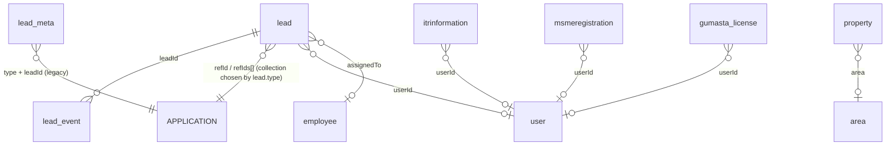

# Probiz Finance: Firestore Data Model

Stage 5 design document (not yet implemented). Generated from the 47 schema files in `server/models/` at commit `9f2bb93`; field tables were produced by loading the schema definitions, not by hand. See [firebase-architecture.md](firebase-architecture.md) for the adapter and query design.

## 1. Conventions (all collections)

| Topic | Rule |
|---|---|
| Database | Default Firestore database only (the only one with a free quota). Standard edition |
| Collection name | Existing table name from `tableName(modelName)` in `server/odm.js` (camelCase to snake_case, other characters to `_`, lower-case). Keeps migration and rollback one to one |
| Document ID | Existing UUID v4 string (`crypto.randomUUID()`), exposed as `_id`; preserved by migration. Internal collections use deterministic SHA-256 hex IDs |
| `_id` | Not stored as a field; it is the document ID |
| `createdAt`, `updatedAt` | Firestore Timestamps on every document (including `property_in_house`, whose schema has no timestamps; there they are internal and not returned, as today). Millisecond precision (Postgres keeps microseconds) |
| Dates | Fields typed `Date` become Timestamps and are converted back to `Date` on read, including inside arrays and nested objects. `Date` values inside Mixed fields are stored as ISO strings, exactly as Postgres stores and returns them today (Stage 7 decision) |
| `default: null` fields | Always stored; written as `null` when unset (Stage 7), so `{ field: null }` filters run natively |
| `ObjectId` fields | Stored as strings (as today) |
| `undefined` | Removed before writing |
| `_lc` | Reserved map with lower-cased copies of case-insensitive lookup fields (section 4). Written by the adapter on every insert and update, removed on read. Implemented in Stage 7 |
| Unknown keys | Dropped by schema casting before writes (strict mode, as today) |
| Size | Documents must stay under 1 MiB; only `credit_score.reportRaw`/`reportPdfRaw` could approach this (section 6) |

Validation (required, enum, match, min, max, casting, defaults) stays in the model files and runs before every write, exactly as today. Firestore itself is schemaless.

## 2. Collection catalogue

Sensitivity codes: **C** credentials (password hashes), **P** personal data (names, phones, emails, addresses, dates of birth), **F** financial data (income, loan amounts, CIBIL score, bank details), **K** identity numbers (Aadhaar, PAN), **D** references to uploaded private documents, **Pub** intended to be public, **Ops** operational.

### 2.1 People and access

| Collection | Source file | Model name | Schema group | Sensitivity |
|---|---|---|---|---|
| `admin` | admin.model.js | admin | 1 | C, P |
| `admin_roles` | adminRole.model.js | adminRoles | 2 | Ops |
| `employee` | employee.model.js | Employee | 15 | C, P |
| `user` | user.model.js | User | 29 | C, P |

### 2.2 Lead pipeline

| Collection | Source file | Model name | Schema group | Sensitivity |
|---|---|---|---|---|
| `lead` | lead.model.js | Lead | 22 | P (name, phone, email, amount, consent, attribution) |
| `lead_event` | leadEvent.model.js | LeadEvent | 23 | P (notes, actor names) |
| `lead_meta` | leadMeta.model.js | LeadMeta | 24 | P (legacy notes); read only by the backfill |

### 2.3 Application collections (one per lead type in `server/admin/leads.js`)

| Collection | Source file | Model name | Lead type | Schema group | Sensitivity |
|---|---|---|---|---|---|
| `loan_offer` | homeloan.model.js | LoanOffer | homeloan | 18 | P, F, D |
| `plot_purchase_loan_offer` | plotpurchase.model.js | PlotPurchaseLoanOffer | plotpurchase | 10 | P, F, D |
| `plot_purchase_construction_loan_offer` | plotPurchaseConstruction.model.js | PlotPurchaseConstructionLoanOffer | plotconstruction | 10 | P, F, D |
| `flate_purchase_loan_offer` | flatepurchase.model.js | FlatePurchaseLoanOffer | flatpurchase | 10 | P, F, D |
| `loanagainst_property` | loanagainstProperty.model.js | LoanagainstProperty | lap | 10 | P, F, D |
| `construction_loan_application` | constructionLoan.model.js | ConstructionLoanApplication | construction | 10 | P, F, D |
| `home_renovation_loan` | homerenovation.model.js | HomeRenovationLoan | renovation | 10 | P, F, D |
| `commercial_property_purchase` | commercialPropertyPurchase.js | CommercialPropertyPurchase | commercialpurchase | 10 | P, F, D |
| `commercial_property_mortage_purchase` | commercialPropertyMortagePurchase.js | CommercialPropertyMortagePurchase | commercialmortgage | 10 | P, F, D |
| `balance_transfer` | balanceTransfer.model.js | BalanceTransfer | balancetransfer | 5 | P, F, D |
| `balance_transfer_top_up` | balanceTransferTopUp.model.js | BalanceTransferTopUp | bttopup | 6 | P, F, D |
| `personal_loan` | pLoan.module.js | PersonalLoan | personal | 27 | P, F, D |
| `business_loan_application` | bloan.model.js | BusinessLoanApplication | business | 7 | P, F, D |
| `pradham_mantri_loan` | pradhanmantri.model.js | PradhamMantriLoan | mudra | 27 | P, F, D |
| `project_funding_loan_application` | projectFunding.model.js | ProjectFundingLoanApplication | projectfunding | 7 | P, F, D |
| `car_loan_application` | carLoan.model.js | CarLoanApplication | car | 9 | P, F, D |
| `education_loan_application` | education.model.js | EducationLoanApplication | education | 14 | P, F, D |
| `gold_loan` | gold.model.js | GoldLoan | gold | 16 | P, F |
| `kisan_credit_loan_application` | kisanCreditCard.model.js | KisanCreditLoanApplication | kisan | 21 | P, F, D |
| `credit_card` | creditcard.model.js | CreditCard | creditcard | 13 | P, F, D |
| `health_insurance` | healthInsurance.js | healthInsurance | health | 4 | P |
| `automobile_insurance` | automobile.model.js | Automobile Insurance | motor | 4 | P |
| `investment_plan` | investment.model.js | Investment Plan | investment | 4 | P |
| `caservice` | caService.model.js | CAService | ca | 8 | P |
| `legal_doc_schema` | legalDoc.model.js | legalDocSchema | legal | 8 | P |
| `estamp` | eStamp.model.js | EStamp | estamp | 8 | P |
| `government_business` | governmentBusi.model.js | GovernmentBusiness | government | 8 | P |
| `business_consultation` | businessConsultation.model.js | BusinessConsultation | consultation | 8 | P |
| `credit_score` | creditScore.model.js | CreditScore | creditscore | 12 | P, F (credit report payloads) |
| `digital_marketing` | digitalMarketing.model.js | DigitalMarketing | marketing | 8 | P |
| `real_state_service` | realState.model.js | RealStateService | realestate | 8 | P |
| `dsaservice` | dsaService.model.js | DSAService | dsa | 8 | P |
| `contact` | contact.model.js | Contact | contact | 11 | P |
| `property_in_house` | inHouse.model.js | Property InHouse | inhouse | 19 | P, F |
| `itrinformation` | itrInformation.model.js | ITRInformation | itr | 20 | P, F, K (PAN, bank account) |
| `msmeregistration` | msmeRegistration.model.js | MSMERegistration | msme | 25 | P, F, K (Aadhaar, PAN, bank account) |
| `gumasta_license` | gumastaLicense.model.js | GumastaLicense | gumasta | 17 | P, K (Aadhaar, PAN) |

### 2.4 Website content

| Collection | Source file | Model name | Schema group | Sensitivity |
|---|---|---|---|---|
| `property` | property.model.js | Property | 28 | Pub (listings; owner name and contact are published) |
| `area` | area.model.js | Area | 3 | Pub |
| `news_latters` | newslatter.model.js | NewsLatters | 26 | P (subscriber emails) |

### 2.5 Internal collections (new)

| Collection | Document ID | Fields | Purpose | Sensitivity |
|---|---|---|---|---|
| `locks` | `sha256(lock key)` | `at` | Serialises transactions on the same key: lead duplicate key (`lead:dedupe:<type>:<phone>`), per-form record (`lead:ref:<type>:<id>`), and unique values (`unique:<collection>:<field>:<value>`). Read and rewritten inside each transaction (Stage 8) | Ops (no raw key stored) |
| `rate_limits` | `sha256(rule key)` | `kind` (key prefix, `lead`), `windowStart`, `windowSeconds`, `count`, `expiresAt` | Fixed-window rate limits (Stage 8) | Ops |
| `system_health` | `ping` (never written) | none | Read target for `/api/health` (Stage 8) | Ops |
| `site_settings` | `contact_social` (only record) | `primaryPhone`, `secondaryPhone`, `whatsappPhone` (10 digits), `contactEmail`, `social { linkedin, youtube, instagram, facebook }`, `updatedBy` (admin ID), `updatedByName`, `createdAt`, `updatedAt` | Public contact details and social links edited in the admin panel (Stage 8.5). Model `server/models/siteSettings.model.js`; same table name on Postgres. Created by `npm run seed:site-settings` only if missing; migrated like any other model (Stage 10) | Pub (contact details) plus Ops (`updatedBy`, never returned by the public API) |
| `unique_keys` (not used) | | | Stage 5 proposal, replaced in Stage 8 by a `locks` document plus an in-transaction duplicate query (no reservation records to migrate or release) | |
| `system_migrations` (not used) | | | Stage 10 uses local checkpoint files and `_migration_files` instead; Stage 8 needs no backfill marker (on Firestore the backfill only runs on request) | |
| `_migration_files` | `sha256(collection, record ID, field, SHA-256 of the legacy URL)` | `collection`, `docId`, `field` (path array), `legacySource` (`local` or `supabase`), `legacyKey` (object key in the legacy bucket), `legacyRefSha256`, `objectPath`, `pfRef`, `sha256`, `size`, `contentType`, `status` (`pending`, `migrated`, `verify-failed`), `createdAt`, `verifiedAt`, `migratedAt` | Stage 10 manifest of the legacy KYC file move: resumes safely, prevents duplicate copies and feeds the retirement report. Written only by the migration utility (Admin SDK; client access denied by the rules) | Ops (no file contents or personal data; `legacyKey` still locates the public legacy copy until it is retired) |
| `catalog_snapshots` (proposed, F1) | `property_list` | compact copy of all public listing fields, `updatedAt` | One read serves public property list and filter requests; rebuilt on property create, update and delete | Pub |

The raw lock and rate-limit keys contain phone numbers, email addresses and client IPs (today's Postgres `rate_limits.key` stores them in plain text). In Firestore only their SHA-256 hash is stored, as the document ID. Lock documents are small (one timestamp) and are never needed after their transaction; about two are written per new lead.

No `files` collection is needed: uploaded-file references stay in the existing string fields (section 5), and file metadata lives on the storage object.

## 3. Relationships

- `lead.type` selects the application collection through the registry in `server/admin/leads.js`; `lead.refIds` lists every submission merged into the lead (newest in `refId`).
- `lead.assignedName` and `lead_event.actor.name` are denormalised copies, as today.
- `lead.dedupeKey` = `<type>:<last 10 digits of phone>`.
- There are no foreign-key constraints in either backend; references are plain strings.

## 4. Unique values and case-insensitive fields

| Collection | Field | Unique | `_lc` copy | Normalisation | Released when |
|---|---|---|---|---|---|
| `area` | `name` | yes (schema `unique: true`) | yes | trim (uniqueness), lower-case (lookup) | document deleted |
| `admin` | `admin_Email` | yes (new, enforces `createAdmin` intent) | yes | trim, lower-case | document deleted |
| `employee` | `email` | yes among non-deleted (new) | yes | trim, lower-case | soft delete or document deleted |
| `employee` | `employeeId` | yes among non-deleted (new) | no | trim | soft delete or document deleted |
| `user` | `user_Email` | yes (new, case-insensitive; decision D2) | yes | trim, lower-case | document deleted |
| `user` | `mobile_no` | yes (new) | no | digits only | document deleted |

The legacy `createEmployee` (`server/controllers/employee.controller.js`) also rejects matches among deleted employees; that stricter check stays.

Implemented in Stage 8 (both backends): each create runs its duplicate check and write in one native transaction locked on the value (section 2.5 `locks`; `pg_advisory_xact_lock` on Postgres). Rules match today's checks, except where noted:

| Where | Field | Check |
|---|---|---|
| Any `save()` of `area` | `name` | schema `unique: true`, exact value, all records (as before) |
| `createAdmin` | `admin_Email` | case-insensitive, all records (before: exact value, so `A@x.com` could duplicate a stored `a@x.com`) |
| Staff panel `addEmployee` | `email`, `employeeId` | non-deleted employees; email case-insensitive; both compared trimmed, as they are stored |
| Legacy `AddEmployee` | `email`, `employeeId` | exact values, all records (as before) |
| `userSignUp` | `user_Email`, `mobile_no` | exact values, all records (as before; decision D2 still pending) |

Updates that change these fields (legacy `UpdateEmployee`, `updateArea`) keep today's behaviour; `updateArea` is also protected by the schema rule.

Migration reports any existing duplicates for these fields before writing (see the migration plan).

## 5. Uploaded-file fields

Stage 9: with `FILE_STORAGE_BACKEND=firebase`, the existing string fields below hold `pf:private/documents/YYYY/MM/<uuid>.<ext>` for customer documents, and a download-token URL for property media (`propertyImage[]`, `propertyVideo`). No schema change. Records created before Stage 9 keep their original URLs.

These string fields hold file references. Today they contain public URLs (`https://.../storage/v1/object/public/...` or `/uploads/...`). After Stage 9 new private uploads hold an opaque reference `pf:<object path>`; public listing media keep a URL.

| Collection(s) | Fields | Visibility |
|---|---|---|
| `property` | `propertyImage[]`, `propertyVideo` | Public |
| Schema group 10 (8 collections) and `loan_offer` | `uploadedDocuments.{aadharFront, aadharBack, panCard, electricityBill, propertyFront, propertyInside, propertyTaxReceipt, bankStatement, incomeTaxReturnFile, salarySlipOrOfferLetter, forBusiness, propertyPaper}` | Private |
| `balance_transfer` | `uploadedDocuments.{aadharFront, aadharBack, panCard, electricityBillOrRentAgreement, officeShopProof, propertyPhotoFront, propertyPhotoInside, bankStatement, incomeTaxReturnFile, businessProof, loanAccountStatement, listOfDocuments, foreclosureLetter}` | Private |
| `balance_transfer_top_up` | `uploadedDocuments.{aadharFront, aadharBack, panCard, electricityOrRentAgreement, officeShopElectricityOrRent, propertyPhotoFront, propertyPhotoInside, bankStatementLastYear, incomeTaxReturnFile, forBusinessDocuments, loanAccountStatement, listOfDocumentsByBank, foreclosureLetter}` | Private |
| `business_loan_application`, `project_funding_loan_application` | `uploadedDocuments.{aadharFront, aadharBack, panCard, electricityBillOrRentAgreement, bankStatement, incomeTaxReturnFile, businessDocuments}` | Private |
| `car_loan_application` | `uploadedDocuments.{aadharFront, aadharBack, panCard, electricityBillOrRentAgreement, carPhoto, carRC, carQuotation, insurance, bankStatement, salarySlipOrOfferLetter, businessDocuments}` | Private |
| `credit_card` | `uploadedDocuments.{aadharFront, aadharBack, panCard, electricityBill, bankStatement, salarySlipOrOfferLetter}` | Private |
| `education_loan_application` | `uploadedDocuments.{admissionLetter, previousMarkSheets, feeStructure}` | Private |
| `kisan_credit_loan_application` | `uploadedDocuments.{aadharFront, aadharBack, panCard, electricityBill, bankStatement, incomeTaxReturnFile, pawti, khasraCopy}` | Private |
| `personal_loan`, `pradham_mantri_loan` | `uploadedDocuments.{aadharFront, aadharBack, panCard, electricityBillOrRentAgreement, bankStatement, incomeTaxReturnFile, salarySlips, offerLetter}` | Private |

`itrinformation.signature` and `msmeregistration.signature` are text fields, not uploads.

## 6. Field reference by schema group

Generated from the schema definitions. "Required" reflects the schema `required` option; "Default" is the schema default; constraints are enforced by the shared validation before any write. Collections with identical schemas share a group.

### Group 1: `admin`

Timestamps: yes.

| Field | Type | Required | Default | Constraints |
|---|---|---|---|---|
| admin_Name | String | yes |  |  |
| admin_Email | String | yes |  | unique (new, case-insensitive) |
| password | String | yes |  | bcrypt hash (C) |
| deleteFlag | Boolean |  | false |  |

### Group 2: `admin_roles`

Timestamps: yes.

| Field | Type | Required | Default | Constraints |
|---|---|---|---|---|
| rollName | String | yes |  |  |
| permission[] | Array of maps |  | [] |  |
| permission[].tabName | String | yes |  |  |
| permission[].tabAcess | Array of String |  | [] |  |

### Group 3: `area`

Timestamps: yes.

| Field | Type | Required | Default | Constraints |
|---|---|---|---|---|
| name | String | yes |  | unique; trim |
| city | String |  | "" | trim |
| state | String |  | "" | trim |
| pinCode | String |  | "" | trim |
| isActive | Boolean |  | true |  |
| deleteFlag | Boolean |  | false |  |

### Group 4: `automobile_insurance`, `health_insurance`, `investment_plan`

Timestamps: yes.

| Field | Type | Required | Default | Constraints |
|---|---|---|---|---|
| loan_Type | String | yes |  |  |
| first_Name | String | yes |  |  |
| last_Name | String | yes |  |  |
| email | String |  |  |  |
| mobile_no | String | yes |  |  |
| dateOfBirth | String | yes |  |  |

### Group 5: `balance_transfer`

Timestamps: yes. All fields optional strings: `fullName`, `dateOfBirth`, `address`, `contactNumber`, `alternateContact`, `propertyType`, `loanAmount`, `noOfStallmentCurrentLoan`, `profession`, `incomeType`, `monthlyIncome`, `incomeTaxReturn`, `cibilScore`, and the 13 `uploadedDocuments.*` fields listed in section 5.

### Group 6: `balance_transfer_top_up`

Timestamps: yes. All fields optional strings: `fullName`, `dateOfBirth`, `address`, `contactNumber`, `alternateContact`, `residenceType`, `currentLoanAmount`, `currentLoanInstallmentsPaid`, `loanAmountRequired`, `profession`, `incomeType`, `totalMonthlyIncome`, `incomeTaxReturn`, `cibilScore`, and the 13 `uploadedDocuments.*` fields listed in section 5.

### Group 7: `business_loan_application`, `project_funding_loan_application`

Timestamps: yes.

| Field | Type | Required |
|---|---|---|
| fullName | String | yes |
| dateOfBirth | String | yes |
| address | String | yes |
| contactNumber | String | yes |
| alternateContactNumber | String |  |
| businessName | String |  |
| loanAmountRequired | Number |  |
| incomeType | String |  |
| totalMonthlyIncome | Number |  |
| incomeTaxReturn | String |  |
| businessCertificate | String |  |
| cibilScore | Number |  |
| uploadedDocuments.* (7 fields, section 5) | String |  |

### Group 8: `business_consultation`, `caservice`, `digital_marketing`, `dsaservice`, `estamp`, `government_business`, `legal_doc_schema`, `real_state_service`

Timestamps: yes.

| Field | Type | Required |
|---|---|---|
| name | String | yes |
| email | String | yes |
| mobile_no | String | yes |
| message | String |  |

### Group 9: `car_loan_application`

Timestamps: yes.

| Field | Type | Required |
|---|---|---|
| fullName | String | yes |
| dateOfBirth | String | yes |
| address | String | yes |
| contactNumber | String | yes |
| alternateContactNumber | String | yes |
| carType, carBrand, brand, yearOfMake, onRoadPrice, loanAmountRequired | String |  |
| profession, incomeType, totalMonthlyIncome, incomeTaxReturn, businessCertificate, cibilScore, otherIncomeSource, otherIncomeAmount | String |  |
| uploadedDocuments.* (11 fields, section 5) | String |  |

### Group 10: `commercial_property_mortage_purchase`, `commercial_property_purchase`, `construction_loan_application`, `flate_purchase_loan_offer`, `home_renovation_loan`, `loanagainst_property`, `plot_purchase_construction_loan_offer`, `plot_purchase_loan_offer`

Timestamps: yes. All fields optional strings: `fullName`, `dateOfBirth`, `address`, `contactNumber`, `alternateContact`, `propertyType`, `propertySize`, `constructionSize`, `marketValue`, `loanAmount`, `profession`, `incomeType`, `monthlyIncome`, `incomeTaxReturn`, `businessCertificate`, `cibilScore`, `otherIncomeSource`, `otherIncomeAmount`, and the 12 `uploadedDocuments.*` fields listed in section 5.

### Group 11: `contact`

Timestamps: yes. `name`, `email`, `mobile_no`, `message`: all required strings.

### Group 12: `credit_score`

Timestamps: yes.

| Field | Type | Required | Default | Constraints |
|---|---|---|---|---|
| name | String | yes |  |  |
| email | String | yes |  |  |
| mobile_no | String | yes |  |  |
| message | String |  |  |  |
| status | String |  | "initiated" | enum initiated, success, failed |
| provider | String |  | "surepass" |  |
| providerRefId | String |  |  |  |
| bureau | String |  |  |  |
| score | Number |  |  |  |
| reportRaw | Mixed |  |  | may be large: write fails above 1 MiB (risk accepted; the provider integration is a stub today) |
| reportPdfRaw | Mixed |  |  | same |
| errorMessage | String |  |  |  |

### Group 13: `credit_card`

Timestamps: yes. Required strings: `fullName`, `dateOfBirth`, `address`, `contactNumber`, `alternateContact`. Optional strings: `profession`, `incomeType`, `monthlyIncome`, `cibilScore`, and the 6 `uploadedDocuments.*` fields in section 5.

### Group 14: `education_loan_application`

Timestamps: yes. All optional strings: `fullName`, `fatherOrHusbandName`, `dateOfBirth`, `permanentAddress`, `contactNumber`, `email`, `courseName`, `institutionName`, `institutionAddress`, `admissionDate`, `courseDuration`, `totalFees`, `loanAmountRequired`, `occupationOrBusiness`, `monthlyOrAnnualIncome`, `coApplicantName`, `coApplicantFatherOrHusbandName`, `coApplicantDateOfBirth`, `coApplicantRelationship`, `coApplicantAddress`, `coApplicantContact`, `coApplicantIncome`, `collateralType`, `collateralLocation`, `collateralMarketValue`, and `uploadedDocuments.{admissionLetter, previousMarkSheets, feeStructure}`.

### Group 15: `employee`

Timestamps: yes.

| Field | Type | Required | Default | Constraints |
|---|---|---|---|---|
| name | String | yes |  |  |
| mobile | String | yes |  |  |
| email | String | yes |  | unique among non-deleted (new, case-insensitive) |
| roll | String | yes |  | job title |
| password | String | yes |  | bcrypt hash (C) |
| employeeId | String | yes |  | unique among non-deleted (new) |
| deleteFlag | Boolean |  | false |  |

### Group 16: `gold_loan`

Timestamps: yes. Required strings: `fullName`, `dateOfBirth`, `permanentAddress`, `contactNumber`. Optional strings: `fatherOrHusbandName`, `motherName`, `email`, `occupationOrBusiness`, `monthlyOrAnnualIncome`, `goldType`, `goldPurity`, `loanPurpose`, `preferredRepaymentTenure`. Optional numbers: `goldWeightInGrams`, `loanAmountRequired`.

### Group 17: `gumasta_license`

Timestamps: yes.

| Field | Type | Required | Default | Constraints |
|---|---|---|---|---|
| userId | String (ObjectId) |  |  | ref `user` |
| applicantAuthorizedPersonName, fatherSpouseName, designation, mobileNo, emailId | String | yes |  |  |
| aadhaarNo | String | yes |  | K |
| panNo | String | yes |  | K |
| firmName, buildingShopNo, streetRoad, areaLocality, city, district, pinCode, natureOfBusinessActivity, premisesStatus | String | yes |  |  |
| category.shop, category.commercialEstablishment | Boolean |  | false |  |
| dateOfEstablishment | Date | yes |  |  |
| totalEmployeesMale, totalEmployeesFemale, totalEmployeesDifferently | Number |  | 0 |  |
| documentChecklist.{panCopy, aadhaarCopy, addressProof, photographOfSignboard, rentLeaseAgreement} | Boolean |  | false |  |
| status | String |  | "pending" | enum pending, in_progress, completed, rejected |
| remarks | String |  | "" |  |

### Group 18: `loan_offer`

Timestamps: yes. Same fields as group 10 plus `gstNumber` (String).

### Group 19: `property_in_house`

Timestamps: no (internal `createdAt`/`updatedAt` kept but not returned).

| Field | Type | Required | Default | Constraints |
|---|---|---|---|---|
| name | String |  |  | trim |
| contactNumber | String |  |  | match `^[0-9]{10}$` |
| alternateContactNumber | String |  | "" | match `^[0-9]{10}$` |
| budget | Number |  |  | min 0 |
| location, size, propertyType, houseFacing | String |  |  |  |
| bhk | String |  |  | `min 0` declared (no effect on strings) |
| width, length, loanAmountRequired, cashInHand | Number |  |  | min 0 |

### Group 20: `itrinformation`

Timestamps: yes.

| Field | Type | Required | Default | Constraints |
|---|---|---|---|---|
| userId | String (ObjectId) |  |  | ref `user` |
| formType | String | yes |  | enum job, business |
| fullName | String |  |  |  |
| pan | String | yes |  | uppercase; match PAN format (K) |
| dateOfBirth | Date | yes |  |  |
| mobile | String | yes |  | match 10 digits |
| email | String | yes |  | lowercase; match email |
| annualGrossSalary, tdsAsPerForm16, savingsAccountInterest, otherIncome, eligibleDeductions, tdsAsPerForm26AS, advanceSelfAssessmentTax, totalTurnoverReceipts, totalExpenses, netProfit, tdsTotalForm26AS, advanceSelfAssessmentTaxBusiness, otherIncomeBusiness, eligibleDeductionsBusiness | Number |  | 0 | F |
| otherIncomeDescription, deductionsDescription, otherIncomeBusinessDescription, deductionsBusinessDescription, remarks | String |  | "" |  |
| nameOfIndividualOrFirm | String |  |  |  |
| accountNumber | String | yes |  | F |
| ifscCode | String | yes |  | uppercase; match IFSC |
| bankName | String | yes |  |  |
| accountType | String | yes |  | enum Savings, Current, Fixed Deposit, Recurring Deposit |
| place, signature | String | yes |  |  |
| declarationDate | Date | yes |  |  |
| status | String |  | "pending" | enum pending, in_progress, completed, rejected |

### Group 21: `kisan_credit_loan_application`

Timestamps: yes. Required strings: `fullName`, `dateOfBirth`, `address`, `contactNumber`. Optional: `alternateContactNumber`, `residenceType`, `incomeType` (String); `totalLand`, `monthlySalary`, `cibilScore` (Number); `pawti`, `incomeTaxReturn` (Boolean); and the 8 `uploadedDocuments.*` fields in section 5.

### Group 22: `lead`

Timestamps: yes.

| Field | Type | Required | Default | Notes |
|---|---|---|---|---|
| type | String | yes |  | lead type key |
| formKey | String |  | null | website form key |
| refId | String | yes |  | latest application document ID |
| refIds | Array of String |  | [] | all merged application IDs |
| name, phone, email, amount, detail | String |  | null | summary copied from the application |
| status | String |  | "new" | new, contacted, in_progress, won, lost |
| assignedTo | String |  | null | `employee` ID |
| assignedName | String |  | null | denormalised |
| userId | String |  | null | `user` ID |
| source | Mixed |  | null | `{ channel, topic, page, referrer, landingPage, device, utm }` |
| consent | Mixed |  | null | `{ accepted, version, text, at }` (`at` is stored as an ISO string, as in Postgres today, because `consent` is Mixed) |
| dedupeKey | String |  | null | `<type>:<10-digit phone>` |
| repeatCount | Number |  | 0 |  |
| lastActivityAt | Date |  | null |  |

### Group 23: `lead_event`

Timestamps: yes. `leadId` (String, required), `type` (String, required), `at` (Date, required), `actor` (Mixed, default null: `{ kind, id, name }`), `data` (Mixed, default null).

### Group 24: `lead_meta`

Timestamps: yes. `type`, `leadId` (String, required), `status` (default "new"), `assignedTo`, `assignedName` (default null), `notes[]` of `{ text, by, at (Date) }`.

### Group 25: `msmeregistration`

Timestamps: yes.

| Field | Type | Required | Default | Constraints |
|---|---|---|---|---|
| userId | String (ObjectId) |  |  | ref `user` |
| aadhaarNo | String | yes |  | match 12 digits (K) |
| nameOnAadhaar | String | yes |  |  |
| mobileLinkedToAadhaar | String | yes |  | match 10 digits |
| email | String | yes |  | lowercase; match email |
| enterpriseName | String | yes |  |  |
| organisationType | String | yes |  | enum Proprietor, Partnership, LLP, Pvt Ltd, Other |
| pan | String | yes |  | uppercase; match PAN (K) |
| gstin | String |  |  | uppercase; match GSTIN |
| doorShopNo, street, areaLocality, city | String | yes |  |  |
| pinCode | String | yes |  | match 6 digits |
| date | Date | yes |  |  |
| majorActivity | String | yes |  | enum Manufacturing, Services |
| nicCode | String | yes |  | match 2 digits |
| description | String |  | "" |  |
| totalEmployeesMale, totalEmployeesFemale, totalEmployeesOthers | Number |  | 0 | min 0 |
| investmentInMachineryEquipment, annualTurnoverLastFY | Number | yes |  | min 0 (F) |
| accountNumber | String | yes |  | F |
| ifscCode | String | yes |  | uppercase; match IFSC |
| bankName | String | yes |  |  |
| accountType | String | yes |  | enum Savings, Current, Fixed Deposit, Recurring Deposit |
| place, signature | String | yes |  |  |
| declarationDate | Date | yes |  |  |
| status | String |  | "pending" | enum pending, in_progress, completed, rejected |
| remarks | String |  | "" |  |

### Group 26: `news_latters`

Timestamps: yes. `email` (String, required).

### Group 27: `personal_loan`, `pradham_mantri_loan`

Timestamps: yes. Required strings: `fullName`, `dateOfBirth`, `address`, `contactNumber`. Optional strings: `alternateContactNumber`, `companyName`, `reportingManagerName`, `reportingManagerContactNumber`, `residenceType`, `profession`, `incomeType`, `incomeTaxReturn`. Optional numbers: `loanAmountRequired`, `monthlySalary`, `cibilScore`. Plus the 8 `uploadedDocuments.*` fields in section 5.

### Group 28: `property`

Timestamps: yes.

| Field | Type | Default | Notes |
|---|---|---|---|
| ownerName, contactNo, propertyName, bhk_of_house, buildUp_type, propertyType, city, state, address, description, carpetArea, propertyVideo, houseFacing, furnishingStatus | String | "" | published |
| buildUpArea, construction_year, bathrooms, plotArea, numberOfBalconies | String | 0 (cast to "0") | schema type String with numeric default |
| price | Number | 0 | range filter |
| area | String (ObjectId) |  | ref `area` |
| areaName | String | "" | trim; substring filter |
| propertyImage | Array of String | [] | public media URLs |

### Group 29: `user`

Timestamps: yes.

| Field | Type | Required | Default | Constraints |
|---|---|---|---|---|
| user_Name | String | yes |  |  |
| user_Email | String | yes |  | unique (new, case-insensitive) |
| country_code | String |  |  |  |
| mobile_no | String | yes |  | unique (new, digits) |
| password | String | yes |  | bcrypt hash (C) |
| isActive | Boolean |  | true |  |
| deleteFlag | Boolean |  | false |  |

## 7. Read and write patterns

| Collection | Reads | Writes |
|---|---|---|
| `admin` | by ID on every admin request (staff guard); `ci(admin_Email)` at login; count of non-deleted (first-admin check); full list in Team page | create (first admin, Team), soft delete, password change |
| `employee` | by ID on every employee request; `ci(email)` at login; non-deleted list (Team, config, assignment); equality on `_lc.email` / `employeeId` before create | create, soft delete, password reset/change, legacy update/delete |
| `user` | by ID (lead linking, lead detail); `ci(user_Email)` at login; equality on email/mobile at signup; non-deleted list and counts (admin) | create, password change |
| `lead` | by ID; dedupe query; paged lists with filters; counts; `assignedTo == id` on employee removal; `type + refIds array-contains` fallback | create/merge in transaction, update in transaction, delete |
| `lead_event` | `leadId == id` (lead page, unbounded per lead but small) | append; batch delete with lead |
| `lead_meta` | full read by the backfill command only | none |
| Application collections | by ID (lead detail, legacy GET by ID); full list (legacy admin list endpoints); ITR/MSME/Gumasta lists with equality filters | create (intake), update by ID (admin), delete by ID |
| `property` | full list sorted by `createdAt` (public, cached 60 s); filtered list (public, cached 60 s); by ID (public); counts | create (public endpoint), update/delete (admin) |
| `area` | `ci(name)` exact lookup; paged list ordered by name; text search (bounded) | create (bulk, seed), update, soft delete |
| `news_latters` | full list (admin); count | create (public), delete (admin) |
| `contact` | full list (admin) | create (intake), delete (admin) |
| `admin_roles` | full list (admin) | create/update/delete (admin) |
| `unique_keys` | by ID inside transactions | create/delete inside transactions |
| `locks` | by ID inside transactions | set inside transactions |
| `rate_limits` | by ID inside transactions; cleanup query `expiresAt < now` limit 50 | set inside transactions; cleanup deletes |
| `system_migrations` | by ID (once per server instance) | set by the backfill and migration commands |

## 8. Composite indexes (for `firestore.indexes.json`)

Automatic single-field indexes serve equality-only queries (including `in` and `array-contains`), single-field ranges and single-field sorts. Composite indexes are needed only where equality filters combine with a pushed-down `orderBy` or a range filter (architecture sections 7.5 and 7.6). Range filters imply an ascending order on the range field, so a range count and a descending sort on the same field need separate indexes (verified, Firestore index overview).

Required:

| # | Collection | Fields | Query that needs it |
|---|---|---|---|
| 1 | `lead` | `dedupeKey` ASC, `status` ASC, `lastActivityAt` DESC | Seven-day duplicate check (`in` on status, range and order on `lastActivityAt`) |
| 2 | `lead` | `type` ASC, `lastActivityAt` DESC | Lead list filtered by product |
| 3 | `lead` | `status` ASC, `lastActivityAt` DESC | Lead list filtered by status |
| 4 | `lead` | `assignedTo` ASC, `lastActivityAt` DESC | Lead list by scope (mine, unassigned, employee; employee view `assignedTo == null OR == me`); recent leads for an employee |
| 5 | `lead` | `source.channel` ASC, `lastActivityAt` DESC | Lead list filtered by channel |
| 6 | `lead` | `phone` ASC, `lastActivityAt` DESC | Lead search by phone number |
| 7 | `lead` | `assignedTo` ASC, `createdAt` DESC | Unassigned pool (latest 5) |
| 8 | `lead` | `assignedTo` ASC, `createdAt` ASC | Employee-scoped date-range counts (last 7 and 30 days, daily counts) |
| 9 | `area` | `deleteFlag` ASC, `name` ASC | Paged area list |
| 10 | `area` | `deleteFlag` ASC, `isActive` ASC, `name` ASC | Paged area list filtered by active flag |
| 11 | `property` | `city` ASC, `price` ASC | Property filter: city + price range |
| 12 | `property` | `propertyType` ASC, `price` ASC | Property filter: type + price range |
| 13 | `property` | `city` ASC, `propertyType` ASC, `price` ASC | Property filter: city + type + price range |

Recommended (not required):

| # | Collection | Fields | Reason |
|---|---|---|---|
| 14 | `lead` | `type` ASC, `refIds` ARRAY_CONTAINS | Resolving old per-form IDs to their lead works without it, but Google recommends an index when `array-contains` is combined with other filters, to avoid slow index merging |

Not needed: equality-only combinations such as per-employee `assignedTo` + `status` counts and the lead-list `total`/`statusCounts` counts, which Firestore serves by merging single-field indexes.

Index exemptions (`fieldOverrides` in `firestore.indexes.json`, added in Stage 6): automatic indexing is turned off for large, never-queried fields: `credit_score.reportRaw`, `credit_score.reportPdfRaw`, `lead_event.data`, `lead.consent` and `lead_meta.notes`. This follows Google's guidance for large map and string fields. It saves storage that counts towards the 1 GiB free tier and avoids the 1,500-byte indexed-value truncation. These are 5 of the 200 single-field configurations allowed without billing.

Lead list queries combining several equality filters (for example type + status + scope, ordered by `lastActivityAt`) are served by Firestore merging indexes 2 to 6, which share the same order field (verified, "Use index merging"). The emulator does not require indexes, so this list must be checked against a real project before production: a missing index returns an error with a creation link. 14 indexes is well within the 200-index limit for projects without billing.

Stage 7 adapter: the `count()` check it runs before pushing a sort down uses the same filters and order as the page query, so it needs no additional index.

## 9. Retention and data-protection notes

Current behaviour (unchanged by this design): nothing is deleted automatically. Applications, leads and events stay until an admin deletes the lead; customers, staff (soft deleted) and subscribers stay indefinitely.

Design additions:

- Deleting a lead also deletes its uploaded files (security plan).
- `rate_limits` entries are removed after their window by in-code cleanup; `locks` are overwritten and can be cleaned by the same script.
- `unique_keys` follow their documents.
- `lead_meta` becomes obsolete after the backfill marker is written; keep it read-only until the business decides on deletion.

Decisions for the business (not technical defaults): how long to keep rejected or closed applications, KYC documents and subscriber emails, and how to handle a customer's request to delete their data. These records contain Aadhaar and PAN numbers, bank details and identity documents, so the retention policy should be confirmed against India's data-protection obligations by whoever owns compliance. The design keeps deletion explicit and auditable (lead events) so a policy can be added later.

## 10. Migration notes per collection

| Collection(s) | Notes |
|---|---|
| All | Same document IDs; `createdAt`/`updatedAt` from the Postgres columns at full microsecond precision; data from the JSONB `data` column as stored, with the adapter's conversion (schema `Date` fields become Timestamps, `_lc` copies). Non-null defaults are not re-applied to old records; fields declared with `default: null` are written as explicit `null` when missing (Firestore `== null` does not match missing fields). Schema violations are reported, never blocking (Stage 10) |
| `admin`, `employee`, `user` | bcrypt hashes copied unchanged and never logged or reported; duplicate unique values (section 4 rules, case-insensitive emails) refuse that collection until a person resolves them (no reservations to create since Stage 8) |
| `area` | Duplicate trimmed names reported; `_lc.name` populated |
| `lead` | `refIds`, `dedupeKey`, `source`, `consent` copied. `lastActivityAt` missing or null becomes `createdAt` (the value the admin list already sorts by), reported. `consent.at` is an ISO string in Postgres (Mixed fields are not cast) and is copied unchanged; new Firestore writes store a Timestamp. Both reach API responses as the same ISO string |
| `lead_event` | Copied with original `at`, including notes |
| `lead_meta` | Copied as-is (historical) |
| Application collections | Copied as-is by the data step; legacy file URLs under `uploadedDocuments` are then moved to private storage by `migrate:files` (verified copy, `pf:` reference, originals kept; see the migration plan, section 8) |
| `property_in_house` | Postgres `created_at` becomes the internal `createdAt` |
| `rate_limits` (Postgres table) | Not migrated (short-lived counters) |
